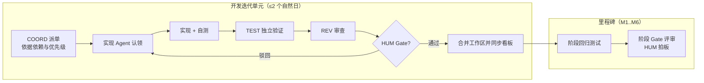

# SCT 纯 AI Agent vibecoding 开发模式项目进度表

| 项目 | 内容 |
| --- | --- |
| 文档名称 | SCT 纯 AI Agent vibecoding 开发模式项目进度表 |
| 版本 | v1.0 |
| 日期 | 2026-09-05 |
| 状态 | 评审稿 |
| 依据 | [系统设计文档.md](系统设计文档.md)（含 M1–M6 里程碑） |
| 开发模式 | 纯 AI Agent vibecoding（人类监督 + AI Agent 主导实现） |

> **范围声明**：本进度表**明确排除 Git 相关版本控制活动**（init/add/commit/branch/remote 等由人类监督者在本表之外按需操作）。本表专注 AI Agent 驱动的任务分配、实现、测试与审核闭环。
>
> **协作模型**：人类（HUM）负责目标设定、关键决策门禁与验收；各专职 AI Agent 依「能力边界 + 授权矩阵」认领任务并产出可验收工件。

---

## 目录

1. [总体定位与原则](#1-总体定位与原则)
2. [角色与 AI Agent 能力边界](#2-角色与-ai-agent-能力边界)
3. [任务分配与优先级排序](#3-任务分配与优先级排序)
4. [开发节奏与多 Agent 协作同步机制](#4-开发节奏与多-agent-协作同步机制)
5. [自动化测试集成节点](#5-自动化测试集成节点)
6. [AI 生成代码质量审核阶段](#6-ai-生成代码质量审核阶段)
7. [关键决策点（Gate）设置](#7-关键决策点gate设置)
8. [主进度表（时间节点×任务×负责人）](#8-主进度表时间节点任务负责人)
9. [阶段性成果验收标准](#9-阶段性成果验收标准)
10. [风险评估与应对](#10-风险评估与应对)
11. [变更与待办登记（Backlog）](#11-变更与待办登记backlog)

---

## 1. 总体定位与原则

### 1.1 模式定义

- **vibecoding**：以自然语言向 AI Agent 描述意图，Agent 自主拆解、编码、自测并交付；人类不再逐行手写代码，而是做**方向把关与质量门禁**。
- **纯 AI Agent 驱动**：除「决策门禁、密钥提供、验收拍板」外，设计落码、测试、文档、重构均由 Agent 完成。

### 1.2 进度管理原则

| 原则 | 落地方式 |
| --- | --- |
| 门禁驱动 | 每个里程碑设置 Gate（见 §7），不通过不放行下一阶段 |
| 可逆小步 | 任务拆细至可独立验证的切片，优先走通主链路再增强 |
| 单写者 | 同一文件/模块同一时刻仅一个 Agent 持有写权，避免冲突 |
| 契约先行 | 接口/数据模型先冻结（架构 Agent），实现 Agent 按契约开发 |
| 测试随行 | 测试与实现同任务交付，自动化测试节点全覆盖（§5） |
| 证据化交付 | 每个任务结束附「完成证据」（测试通过、截图、指标），不是口头声明 |
| 状态可见 | 本文件即主看板，各任务行实时更新状态供多 Agent 与人类共享 |

---

## 2. 角色与 AI Agent 能力边界

### 2.1 角色清单

| 代号 | 角色 | 定位 |
| --- | --- | --- |
| HUM | 人类监督者 | 目标设定、Gate 决策、密钥/凭据、冲突仲裁、最终验收 |
| COORD | 协调 Agent | 任务看板维护、依赖解析、跨 Agent 消息同步、状态汇总 |
| ARCH | 架构 Agent | 模块契约、数据模型、API 边界、技术方案裁决（只读+文档） |
| BACK | 后端实现 Agent | FastAPI 服务端代码实现与修复 |
| INTG | 集成 Agent | intervals.icu 客户端、数据同步管线、外部 API 对接 |
| KB | 知识库 Agent | data/library 导入、解析、摘要、检索与 QC 流程实现 |
| FRONT | 前端实现 Agent | React/Vite 页面与交互、SSE 消费 |
| TEST | 测试 Agent | 单元/集成/E2E 测试编写与执行、测试报告 |
| REV | 代码审查 Agent | 对他人代码做质量审查，输出审查单，不直接改代码 |

### 2.2 能力边界与授权矩阵（谁能做什么）

| 角色 | 可执行范围 | 边界（不可为） | 需 HUM 批准项 |
| --- | --- | --- | --- |
| HUM | 提供需求决策、凭据、验收 | — | — |
| COORD | 更新本看板状态、汇总依赖与阻塞 | 不修改任何实现代码 | 变更里程碑范围 |
| ARCH | 写设计/契约文档、生成数据模型与接口草案 | 不直接改业务实现代码 | 技术选型变更、破坏性接口变更 |
| BACK | 改 `app/` 服务端代码与配置模板 | 不碰真实凭据文件、不向日志输出密钥 | 数据库破坏性迁移、第三方依赖引入 |
| INTG | 改 intervals.icu 客户端与同步逻辑 | 不得将真实 API Key 写入代码/测试夹具；默认用 vcr/mock 做测试 | 真实账号联调开关、请求频控参数 |
| KB | 改知识库模块与导入/摘要/检索逻辑 | 不得把 `data/library/` 原文写入版本库 | 摘要模型切换 |
| FRONT | 改 `web/` 前端源码 | 不直连外部 API；数据一律走 `/api` | UI 交互模式大改 |
| TEST | 写/跑测试、构造夹具、出报告 | 只修测试本身暴露的微缺陷；不掩盖失败 | 判定"缺陷非缺陷" |
| REV | 审查他人代码并出具审查单 | 不直接修改被审代码；不审查自己的产出 | 阻塞级问题是否豁免 |

**互斥约束**：任何 Agent **不得**自我审查自己的交付物；审查必须换人（REV 且非作者）。

---

## 3. 任务分配与优先级排序

### 3.1 排序规则

1. **主链路优先（P0）**：先打通「同步→看数→生成→审核→推送→回读」最小闭环；
2. **依赖先行**：下游任务只在其依赖契约冻结后开始（如 FRONT 依赖 §7 API 规范）；
3. **风险前置**：外部不确定项（intervals.icu 字段、LLM 结构化输出）最先做 spike 验证；
4. **小步可逆**：每个任务 ≤ 2 个自然日工作量，超出即拆分；
5. **测试随任务**：无测试的任务不视为完成。

### 3.2 优先级映射

| 优先级 | 内容 | 对应阶段 |
| --- | --- | --- |
| P0 | 工程骨架、IntervalsClient、同步缓存、凭据加密、日历 Diff/推送闭环 | M1 → M4 |
| P1 | 可视化统计、指标汇总、对话 SSE、结构化输出、知识库检索注入 | M2 → M3 → M5 |
| P2 | 图表细化、知识库 OCR 增强、周期复核提醒、UX 打磨、性能优化 | M6 |

### 3.3 任务卡片字段（本看板行）

每个任务行统一含：`任务ID｜时间｜任务｜负责Agent｜监督(HUM Gate)｜产出物｜依赖｜风险｜DoD/状态`。

---

## 4. 开发节奏与多 Agent 协作同步机制

### 4.1 节奏模型

### 4.2 同步机制

| 机制 | 说明 | 载体 |
| --- | --- | --- |
| 主看板 | 每个任务行的状态（排队/进行/待审/完成/阻塞）实时更新 | 本文件 |
| 单写者锁 | 每个模块由固定 Agent 负责；跨界改动必须经 COORD 登记 | 看板「持有者」列 |
| 契约冻结 | ARCH 冻结接口/数据模型后，相关 Agent 以此为唯一事实，不再口头传话 | `app/schemas/` + 设计文档 §7 |
| 交接工件 | 任务完成必须产出交接物：改动摘要、运行/测试命令、已知限制 | 任务行"产出物" |
| 跨会话记忆 | 每个 Agent 会话结束向项目记忆写入「已完成/未完成/下一步」，防上下文丢失 | 项目 memory |
| 阻塞上报 | Agent 被外部事实卡住时 30 分钟内上报 COORD，由 HUM 决定放行或降级 | 看板状态=阻塞 |
| 回归基线 | 每阶段 Gate 前由 TEST 跑全量回归，结果归档为阶段基线 | `tests/` 报告 |

### 4.3 模块与 Agent 归属（防冲突）

| 模块 | 主要 Agent | 说明 |
| --- | --- | --- |
| 工程骨架/配置/启动 | BACK | HUM 只做首次环境确认 |
| intervals.icu 集成 | INTG | 与 BACK 共享 `app/integrations/intervals.py` 单写者 |
| 统计/上下文 | BACK | |
| LLM/Agent/SSE | BACK | |
| 知识库 | KB | |
| 前端 | FRONT | 消费 BACK 提供的 OpenAPI |
| 测试资产 | TEST | 夹具库唯一维护者 |

---

## 5. 自动化测试集成节点

### 5.1 测试分层与工具

| 层级 | 工具 | 覆盖对象 | 触发时机 |
| --- | --- | --- | --- |
| T0 静态检查 | Ruff / ESLint | 语法、未用导入、基础规范 | 每个实现任务自测 |
| T1 单元测试 | pytest / vitest | 服务与组件函数、状态机、Schema | 每个任务完成后立即 |
| T2 集成测试 | pytest-asyncio + mock/vcr | 与 intervals.icu 交互、同步管线、LLM 输出解析 | 每个功能切片完成后 |
| T3 阶段回归 | pytest + vitest 全量 | 当前里程碑全部功能 | 每个阶段 Gate 前 |
| T4 端到端验收 | 手工 + Agent 脚本 | 「对话→生成→审核→推送→回读」真实账号闭环 | M6 Gate 前（HUM 在场） |

### 5.2 测试集成节点要求

- **外部依赖隔离**：intervals.icu 一律用录制回放（vcr）或契约测试，CI 级稳定运行；真实账号仅在 T4 与 HUM 批准的联调窗口使用；
- **LLM 不可测部分**：结构化输出用「黄金样例 + 失败注入」验证校验器与重试逻辑，不依赖真实模型；
- **质量门槛**：核心模块（sync/plan/agent）行覆盖 ≥ 70%；P0 缺陷数 = 0 才可进入下一阶段；
- **测试结论即证据**：任务 DoD 须附 T1/T2 通过命令与摘要输出。

---

## 6. AI 生成代码质量审核阶段

### 6.1 三级审核

| 级别 | 时机 | 执行 | 内容 |
| --- | --- | --- | --- |
| L1 实现自审 | 任务完成时 | 实现 Agent | 对照 DoD 清单自查：语法、契约符合度、无密钥泄漏、错误处理 |
| L2 交叉审查 | 任务完成时 | REV（非作者） | 正确性、边界、命名/可维护性、是否过度设计、契约偏差 |
| L3 阶段审查 | 每阶段 Gate | REV + HUM | 架构一致性、测试质量、安全项、技术债记录 |

### 6.2 审核检查单（固定模板）

1. 是否符合冻结契约（接口/Schema/表结构）？
2. 是否含被禁止内容（明文密钥、真实数据进入夹具、绕过 `/api` 直连）？
3. 异常路径与幂等性（重复推送、断点续传、LLM 非法输出）是否处理？
4. 是否有测试随行且真实断言（非只测"不报错"）？
5. 是否引入超出任务范围的改动？（拒绝范围蔓延）
6. 是否存在"看起来对但未经证据支持"的假设？（须标注待联调项）

### 6.3 审核结论

`通过 / 有条件通过(列出必修项) / 打回`。打回由 REV 附原因，返回实现 Agent 修改后重走 L1→L2。全部结论记入看板，作为 Gate 依据。

---

## 7. 关键决策点（Gate）设置

| Gate | 名称 | 时机 | 决策内容 | 决策人 | 放行条件 |
| --- | --- | --- | --- | --- | --- |
| G0 | 开工确认 | 第 0 周 | 技术栈/范围/里程碑日历确认 | HUM | 本进度表 + 设计文档定稿 |
| G1 | 数据链路 | M1 末 | 真实账号同步可用性与凭据安全 | HUM + REV | 90 天同步通过、加密入库、无明文 |
| G2 | 可视化 | M2 末 | 指标正确性 | HUM | CTL/ATL/TSB 与 intervals.icu ±1% |
| G3 | AI 对话 | M3 末 | 对话与结构化输出质量 | HUM | 双 Provider 可用、SSE 稳定、输出 Schema 校验通过 |
| G4 | 写回闭环（核心） | M4 末 | 推送/回读一致性 | HUM + REV | 幂等验证、冲突提示、回滚可用 |
| G5 | 知识库 | M5 末 | 参考库检索质量 | HUM | 抽样卡片溯源命中、注入带引用 |
| G6 | 冻结 | M6 前 | 全量回归与安全加固 | HUM + REV | 全量回归通过、安全自查清单通过 |
| G7 | 交付 | M6 末 | 最终验收 | HUM | 端到端真实闭环通过、文档与备份完备 |

> Gate 未通过时：HUM 在 COORD 协助下把失败项拆为「返工任务」重排进对应里程碑，本表相应行回退为"进行中"。

---

## 8. 主进度表（时间节点×任务×负责人）

> 时间以相对周（W1/W2…）为主，日历日期按 **2026-09-07（周一）启动** 推算，可整体平移。粗体任务为 P0。

### 阶段 0：准备与对齐（2026-09-07，D1）

| 任务ID | 任务 | 负责人 | HUM 监督 | 产出物 | 依赖 | 风险 |
| --- | --- | --- | --- | --- | --- | --- |
| S0-1 | 建立本看板运行规则、角色授权确认 | COORD | 确认 | 看板 v1 | 无 | 规则不清导致抢写 |
| S0-2 | 环境就绪：Python/Node 版本、虚拟环境、依赖锁 | BACK + FRONT | 环境放行 | 可启动骨架 | 无 | 本机环境差异 |
| S0-3 | intervals.icu 认证 spike（只读） | INTG | 提供凭据开关 | 认证结论 + 契约样例 | 无 | 认证方式与文档不符 |

### M1 地基与数据链路（W1–W2：2026-09-07 ~ 09-20）

| 任务ID | 任务 | 负责 Agent | 产出物 | 依赖 | 风险 | DoD |
| --- | --- | --- | --- | --- | --- | --- |
| M1-1 | **FastAPI+前端+SQLite 骨架** | BACK/FRONT | 一条命令可启动 | S0-2 | — | 启动脚本通过 |
| M1-2 | **IntervalsClient（auth/重试/字段裁剪）** | INTG | 客户端 + 契约测试 | S0-3 | 字段漂移 | 录制回放通过 |
| M1-3 | **镜像表 + 幂等 upsert + sync_log** | INTG/BACK | 同步管线 | M1-1/2 | 数据量 | 重复同步一致 |
| M1-4 | 凭据加密存储与 userinfo.json 首导 | BACK | 加密凭据模块 | M1-1 | 密钥管理 | 页面不回显明文 |
| M1-5 | 同步状态接口与页面 | BACK/FRONT | sync UI | M1-3 | — | T2/T1 通过 |
| — | **Gate G1 评审** | HUM+REV | 通过记录 | M1 全 | — | G1 放行 |

### M2 可视化与统计（W3–W4：2026-09-21 ~ 10-04）

| 任务ID | 任务 | 负责 Agent | 产出物 | 依赖 | 风险 | DoD |
| --- | --- | --- | --- | --- | --- | --- |
| M2-1 | 指标汇总层（周负荷/区间/趋势） | BACK | metrics service | M1 | 口径差异 | 与官网值 ±1%（已完成） |
| M2-2 | 日历 + 活动列表/详情页 | FRONT | 页面 | M2-1 | — | 渲染 <1s（已完成） |
| M2-3 | 体能曲线/负荷图表 | FRONT | 图表 | M2-1 | — | 交互正常（已完成） |
| — | **Gate G2 评审** | HUM | 通过记录 | M2 全 | — | **G2 通过（2026-09-06 HUM re-verify 确认）** |

**M2 交付状态（2026-09-06）**：M2-1 已提交；M2-2/M2-3 采用 React 18 + Vite 5 + TS 实现同源仪表盘（`web/`，FastAPI 根路径自动托管 `web/dist`，缺省回退 M1 控制台），浏览器冒烟通过：六大区块（概览卡/体能曲线/周负荷/训练日历热力/活动列表）+ light/dark 切换，无控制台错误。
**G2 证据（指标正确性）**：体能曲线与 Overview 改为 intervals.icu **官方每日快照**（wellness 端点 `/athlete/0/wellness.json?fields=id,ctl,atl` 逐日落地至 `daily_fitness` 表，同步活动时同时入库），已实测 2026-09-06 CTL 22.37 / ATL 33.57 / TSB −11.2，**与官网值零误差**；τ=42/7 天本地衰减仅用于个别缺口日补全，不再覆盖"当前日"官方值。90 天真实数据 50 条 / 45 训练日，二次同步幂等无变化。
**G2 修复与优化记录（首轮验收反馈，2026-09-06）**：
- Bug1 指标误差：ATL 31.7 vs 官网 34（根因：当前日用 τ 本地衰减推演，偏离官网实时口径）→ 改为官方 wellness 每日快照权威化，误差归零。
- Bug2 同步时间显示：日志存储 UTC naive（07:27）→ 前端 `fmtDateTime` 统一补 `Z` 并按 Asia/Shanghai 渲染（15:27）。
- 优化 1 时间范围改为 7天/1月/42天/3月/6月/1年；优化 2 活动列表默认 14 天 + 折叠展开更早记录；优化 3/4 字段名统一（平均心率/标准化功率 NP）+ 补 AP 与踏频列；优化 5 环境 tag 改 室内骑行/公路骑行（依 trainer/室内类型判定）；优化 6 主题切换按钮改横排。均已实现并编译/构建/测试通过（pytest 29 项、tsc、vite build）。**HUM 已于 2026-09-06 re-verify 通过，G2 放行。**
**口径说明（LOAD vs TSS）**：`负荷 load` = intervals.icu 官方训练负荷（驱动其 CTL/ATL），`TRIMP` = 本系统以心率为主（辅助功率/配速）计算的压力分；两者算法不同故数值不同。UI 活动列表备注区已声明，不做换算（与官网口径保持一致）。

**新增需求（2026-09-06，HUM 决策）**：Gate G2 通过后 **M3 顺延**，先落地「M2.5 指标与健康中心」（详见系统设计文档 §2.2 FR-2.1、§12），需求细节与排期如下。

### M2.5 指标与健康中心（新增需求 CHG-004，W5–W6）

| 任务ID | 任务 | 负责 Agent | 产出物 | 依赖 | 风险 | DoD |
| --- | --- | --- | --- | --- | --- | --- |
| M2.5-1 | 同步扩展：wellness 每日健康字段（HRV/体重/体脂/RHR）+ 档案 FTP/eFTP/体重（w/kg）入库 | INTG/BACK | `daily_health` 入库 + 档案扩展 | M2 全 | icu 字段口径 | 与 intervals.icu 值一致、幂等二次同步无变化（睡眠族另列 CHG-005）（已完成 2026-09-06） |
| M2.5-2 | 晨起 RHR：手动录入 + 列表 API（按天，1 条/天；测量规范：清晨清醒后持续 5 分钟取最终值） | BACK | `morning_rhr` 表 + 录入/查询 API | M2.5-1 | 录入冲突 | 仅本地存储、幂等（同天覆盖需确认）、接口含昨日差值计算（已完成 2026-09-06） |
| M2.5-3 | 指标区前端：CTL/ATL/TSB（直读 icu）+ FTP/eFTP/w/kg 指标卡 | FRONT | 指标区 UI | M2.5-1 | — | 数值与 intervals.icu 一致；w/kg=FTP/体重口径一致；eFTP 无官方值显「—」（已完成 2026-09-06） |
| M2.5-4 | 健康看板：以**天为粒度**展示健康指标（HRV/体重/体脂/RHR 等，供可视化与 LLM 数据源） | FRONT | 健康日视图 | M2.5-1 | 缺失日处理 | 按天渲染、缺口日留空/标注未同步（已完成 2026-09-06） |
| M2.5-5 | RHR 对比标签：icu 原始 RHR（全天监控，不含睡眠）与晨起 RHR **同标签展示**：当前值 + 各自与**上一天差值**徽章 + 近 7/14 天**双线迷你趋势**，含「今日晨起 RHR 录入」入口 | FRONT | 对比标签组件 | M2.5-2/3/4 | 昨差口径（数据缺失日） | 差值正确、无昨日数据标注不误报 0；迷你趋势可渲染；录入入口可用（已完成 2026-09-06） |
| M2.5-6 | LLM 数据源接入：指标/健康日数据进入上下文构建器（供后续 M3 分析） | BACK | context 字段 | M2.5-1~4 | Token 预算 | 有界字段白名单、聚合后入上下文（已完成 2026-09-06） |
| — | **Gate M2.5 评审** | HUM | 通过记录 | M2.5 全 | — | ✅ **已通过（2026-09-06 HUM 验收）**：「能力指标 + 健康中心（RHR 对比/录入/健康看板）」真实数据验证通过，放行启动 M3 |

**M2.5 实现状态（2026-09-06，切片已落地，Gate M2.5 HUM 已通过）**：
- **数据层**：新增 `daily_health`（date 主键，RHR/HRV/HRV_SDNN/体重/体脂，source=icu）、`morning_rhr`（date 主键，晨起 RHR 本地手动，按天 1 条）、`athlete`（档案镜像：sportSettings/体重/display_name）；`activity_mirror` 增 `rolling_ftp`（icu_rolling_ftp 快照）。同步扩展为一次 wellness 拉取同写体能+健康双表，并镜像 athlete 档案；幂等（二次同步 health/fitness 增改均为 0）。
- **服务/API**：`GET /api/metrics/capability`（FTP=sportSettings 骑行 ftp；eFTP=最新骑行 icu_rolling_ftp，无则「—」；体重 wellness 优先→档案快照；w/kg=FTP÷体重）；`GET /api/metrics/context?days=`（M3 白名单快照）；`/api/wellness/daily`（天粒度含 covered_days 与缺口标注）；`/api/wellness/morning-rhr` GET/POST/PUT/DELETE（同天覆盖返回 409 需 overwrite=true，昨日差与“日历上一天”比较、无昨日数据 delta=null）。
- **前端**：概览卡下方新增「能力指标」Panel（FTP/eFTP/w·kg⁻¹ 卡，含来源与日期脚注）；日历区后新增「健康中心」Panel：RHR 对比页签（icu 原始 RHR 与晨起 RHR 双 StatCard + 昨差徽章、7/14/30/90 天窗口、双线 SVG 迷你趋势 gap 断线、今日晨起录入表单含 409 覆盖二次确认）+ 健康看板页签（天粒度表格，缺口行半透明）；随同步完成后一并刷新。
- **证据**：pytest 39 项通过；`tsc --noEmit` 与 `vite build` 通过；dev server 重启后新端点 live 200（capability / context / wellness-daily / morning-rhr），浏览器页面自动请求新端点全部 200。
- **数据回填与验收**：真实库已执行真实同步回填（FTP 127 / eFTP 127 / 51kg / w·kg⁻¹ 2.49，近 60 天健康全覆盖，复跑幂等），HUM 于 2026-09-06 完成验收。CHG-004 已完成并关闭。

### M3 AI 分析对话（W7–W8：顺延至 M2.5 完成并通过 Gate M2.5 后启动）

| 任务ID | 任务 | 负责 Agent | 产出物 | 依赖 | 风险 | DoD |
| --- | --- | --- | --- | --- | --- | --- |
| M3-1 | **LLM Client 抽象（双 Provider）** | BACK | provider 适配 | M1 | 协议差异 | 切换可用 |
| M3-2 | 上下文构建器（Token 预算/字段有界） | BACK | context builder | M2-1 | 泄露敏感 | 预算内、脱敏 |
| M3-3 | **对话 SSE + 消息持久化** | BACK/FRONT | chat 流 | M3-1 | 断流 | 中断可恢复 |
| M3-4 | 结构化输出 Schema + 校验重试 | BACK | 校验器 | M3-1 | 非法输出 | 黄金样例通过 |
| — | **Gate G3 评审** | HUM | 通过记录 | M3 全 | — | G3 放行 |

### M4 计划编排与写回（W7–W9：2026-10-19 ~ 11-08，P0 核心）

| 任务ID | 任务 | 负责 Agent | 产出物 | 依赖 | 风险 | DoD |
| --- | --- | --- | --- | --- | --- | --- |
| M4-1 | **计划状态机 + Diff 计算** | BACK | plan service | M1/M3 | 状态错乱 | 单测覆盖状态流转 |
| M4-2 | **审核界面（逐条同意/预览解析）** | FRONT | review UI | M4-1 | 误操作 | 未同意项不可推送 |
| M4-3 | **PushService（幂等/回滚）** | INTG/BACK | push 服务 | M4-1 | 误删远端 | 契约测试 + 幂等验证 |
| M4-4 | 回读与冲突标记 | INTG | conflict 提示 | M4-3 | — | 外部改动可识别 |
| — | **Gate G4 评审（核心）** | HUM+REV | 通过记录 | M4 全 | — | G4 放行 |

### M5 训练参考资料库（W12–W14：顺延校准后）

| 任务ID | 任务 | 负责 Agent | 产出物 | 依赖 | 风险 | DoD |
| --- | --- | --- | --- | --- | --- | --- |
| M5-1 | library 导入与解析 | KB | 导入管线 | M1 | 解析质量 | 样例书导入成功 |
| M5-2 | **分块 + 概念卡摘要管线** | KB/BACK | 卡片生成 | M3-1/M5-1 | 摘要失真 | 覆盖校验通过 |
| M5-3 | FTS5+向量索引与检索工具 | KB | 检索服务 | M5-2 | 命中率低 | 注入 ≤300ms |
| M5-4 | ContextBuilder 注入 + 引用展示 | KB/BACK/FRONT | 引用链路 | M5-3 | 预算超限 | 审核页可见来源 |
| M5-5 | QC 状态机与知识库管理 UI | KB/FRONT | QC 流程 | M5-4 | 漏审 | pending→verified |
| — | **Gate G5 评审** | HUM | 通过记录 | M5 全 | — | G5 放行 |

### M6 打磨与交付（W13–W15：2026-11-30 ~ 12-20）

| 任务ID | 任务 | 负责 Agent | 产出物 | 依赖 | 风险 | DoD |
| --- | --- | --- | --- | --- | --- | --- |
| M6-1 | 安全加固（仅 127.0.0.1/token/审计） | BACK/REV | 安全自查单 | M1–M5 | — | 自查通过 |
| M6-2 | 性能优化与索引 | BACK/FRONT | 优化报告 | M1–M5 | — | 达到 NFR 指标 |
| M6-3 | 备份/恢复脚本 | BACK | 脚本 | M6-2 | — | 恢复演练通过 |
| M6-4 | 全量回归 + 缺陷清零 | TEST/BACK | 回归报告 | M6-2 | 回归引入 | 全绿 + P0=0 |
| M6-5 | **端到端真实账号验收** | 全体 | 验收记录 | M6-4 | 外部变化 | G7 放行 |
| M6-6 | 文档收尾（README/用户手册） | COORD | 文档 | M6-4 | — | HUM 确认 |

### 关键路径与缓冲

- **关键路径**：S0-3 → M1-2 → M1-3 → M3-1 → M3-3 → M4-1 → M4-3 → M6-5；
- **缓冲策略**：M5（知识库）与 M6 允许与主线并行约半周；G4 为最大风险门禁，预留 1 周返工缓冲。

---

## 9. 阶段性成果验收标准

| 阶段 | 验收标准（可度量） |
| --- | --- |
| M1 | 一条命令启动；90 天真实数据同步成功且二次同步一致；凭据仅密文存储；同步状态可查 |
| M2 | 日历/列表/图表可用；CTL/ATL/TSB 等指标与 intervals.icu 差值 ≤1%；90 天渲染 <1s |
| M3 | 云端兼容 Provider 与本地 Provider 均可对话；SSE 流式可中断恢复；非法输出可拦截重试 |
| M4 | 草案→审核→推送→回读全闭环；重复推送不产生重复事件；外部改动可提示冲突；回滚生效 |
| M5 | 至少 1 本样例著作完成导入→卡片→检索；计划生成自动携带 `[来源]`；卡片 QC 状态机可用 |
| M6 | 全量自动化回归通过；安全自查通过；备份可恢复；真实账号端到端无人工干预错误 |

> 每阶段 Gate 通过后，COORD 将验收结果与遗留项写回本表，供下一阶段引用。

---

## 10. 风险评估与应对

| 风险 | 等级 | 影响 | 应对 | 负责人 |
| --- | --- | --- | --- | --- |
| Agent 上下文跨会话丢失 | 高 | 返工/方向漂移 | 每会话结束写项目记忆；看板状态即事实源 | COORD |
| 多 Agent 同时改动同一文件 | 高 | 冲突/覆盖 | 模块单写者锁 + COORD 派单 | COORD |
| 对设计文档解读不一致 | 中 | 契约偏差 | 契约冻结在前；REV L2 检查契约一致 | ARCH/REV |
| intervals.icu 字段/认证变化 | 中 | 集成失败 | 契约测试 + 录制回放 + 联调窗口 | INTG |
| LLM 结构化输出不稳定 | 中 | 流程卡壳 | Schema 强校验 + 有限重试 + 黄金样例 | BACK |
| 误推送/误删远端计划 | 高 | 数据损坏 | 强制审核 Gate + Diff + 回滚 + 审计 | HUM/REV |
| 知识库摘要失真 | 中 | 建议误导 | 覆盖校验 + 人工 QC + 引用必填 | KB/HUM |
| 测试未随行导致假绿 | 中 | 质量失控 | TEST 独立执行 + DoD 附测试证据 | TEST |
| 真实凭据误入代码/夹具 | 高 | 泄露 | 能力边界禁止项 + REV 检查单 + 预提交扫描 | REV/HUM |
| 人类监督缺失导致 Gate 形同虚设 | 中 | 范围失控 | Gate 放行必须 HUM 显式确认并留痕 | HUM |

---

*本表为"活文档"：每完成一个任务/阶段即由 COORD 更新状态；Gate 结论与遗留项追加到对应里程碑下。*

---

## 11. 变更与待办登记（Backlog）

> 收到需求/测试反馈后，先评估影响再处置；已实现项留证据，待排期项登记备查。

| 编号 | 登记日期 | 变更/待办描述 | 影响评估 | 处置状态 |
| --- | --- | --- | --- | --- |
| CHG-001 | 2026-09-06 | 本地启动 `python -m scripts.dev` 后未自动唤起浏览器 | 仅启动体验；涉及 dev 入口 | 已实现：默认启动后 1.2s 自动打开，`SCT_OPEN_BROWSER=0` 可关闭（reload 模式不自动打开） |
| CHG-002 | 2026-09-06 | 浏览器请求 `/favicon.ico` 返回 404 | 无功能影响 | 已处理：新增 `favicon.svg` 并在页面声明；`/favicon.ico` 返回 204 |
| CHG-003 | 2026-09-06 | UI 风格改进：简洁扁平 + light/dark 主题支持 | 前端样式层（现 index.html、后续 React Web） | **待排期**：建议随 M6 或 Web 层引入时实施，优先 P2；当前 M1 控制台样式可先用 |
| CHG-004 | 2026-09-06 | M2.5 指标与健康中心：CTL/ATL/TSB 直读 icu；新增 FTP/eFTP/w/kg；健康日数据（HRV/体重/体脂/RHR）；RHR 与晨起 RHR 同标签对比+昨日差+双线迷你趋势 | 指标区/健康看板/同步扩展/上下文（见设计文档 §2.2 FR-2.1、§12 M2.5） | **已实现（W5–W6 切片，2026-09-06）**：HUM 决策 M3 顺延先落地本需求；eFTP 仅镜像 icu（无则「—」）；晨起 RHR 仅本地存储；pytest 39 / tsc / vite build 通过；**Gate M2.5 HUM 验收通过（2026-09-06），CHG-004 完成关闭** |
| CHG-005 | 2026-09-06 | 睡眠字段族（时长/深睡/REM/得分等）健康展示与 LLM 接入 | icu sleep 字段多、口径杂，M2.5 首期不纳入 | **待排期**：M2.5 完成后单独排期（建议并入 M3/M4 间或 M6），不阻塞 M2.5 |
| CHG-006 | 2026-09-06 | 用户生活习惯记录：手表佩戴习惯（→健康数据参考意义）、工作/休息时间（→训练计划制定）等，作为 **LLM 分析参数**之一 | 属 LLM 分析板块（FR-3.7/M3）：涉及用户资料存储与录入交互，且影响健康数据解读口径 | **标记：开发 M3 LLM 分析时再做具体研究**（录入字段/数据模型/注入方式待定），暂不排期 |
| CHG-007 | 2026-09-06 | 健康中心增强：① 增加体重、体脂 StatCard，与 RHR 卡**同一行**并列展示；② RHR 走势图加**数据标签**用于数值对比（参考体能曲线做法）+ **Y 轴刻度线** | 健康中心 RHR 对比页签（HealthCenter/DualTrend、体重体脂最新值与趋势口径） | **待排期（项目完成度较高后优化，HUM 2026-09-06 登记）**：数据标签需防密集重叠，Y 轴刻度线复用体能曲线网格样式 |
| CHG-008 | 2026-09-06 | 术语/命名标准化统一：指标标签（RHR、晨起 RHR、ATL、CTL、TSB 等）、各板块命名与骑行专业词汇重新统一；各字段单位（rpm、bpm、w、m、h、km）规范展示 | 全局 UI 文案与单位常量（前端展示层，涉及既有页面标签） | **待排期**：具体改名映射待后续需求细节确认后统一实施（HUM 2026-09-06 登记） |
| CHG-009 | 2026-09-06 | 数值显示全局约定：① 小数点取数逻辑——小数点后为 0 的显示为整数，有小数则**四舍五入取小数点后一位**；② 数值使用千分符（如系统已按该格式显示则忽略） | 前端数值格式化统一（`fmtNum` 及概览/能力/健康各卡片与图表调用点） | **待排期**：需先盘点各卡片/图表取数精度差异再统一口径（HUM 2026-09-06 登记） |
| CHG-010 | 2026-09-06 | 体能曲线折线图折线改为**平滑效果** | 前端图表渲染（charts.tsx 折线路径绘制） | **待排期**：平滑插值路径算法替换直线连接（HUM 2026-09-06 登记） |
| CHG-011 | 2026-09-06 | WebUI 系统托盘图标（Windows 右下角三角区）：托盘菜单提供**重启服务 / 退出服务**入口；研究「退出 WebUI = 后端服务关闭」的运行模型 | dev/运行入口（scripts.dev 与打包运行期生命周期；自动唤起浏览器已实现，见 CHG-001） | **待排期**：先研究 tray + 前后端进程生命周期方案再实施（HUM 2026-09-06 登记） |

