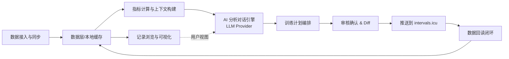
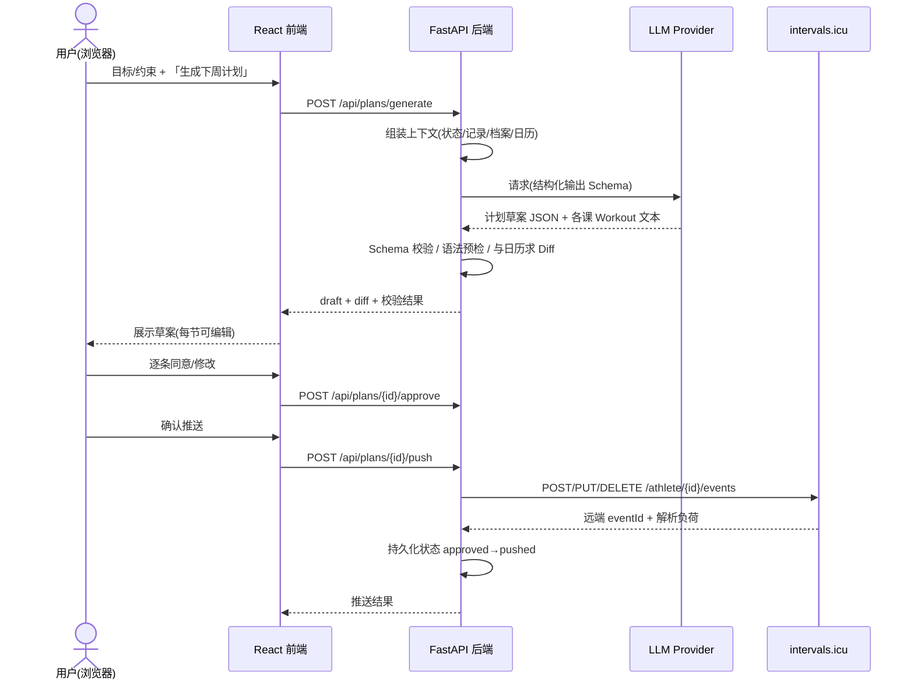
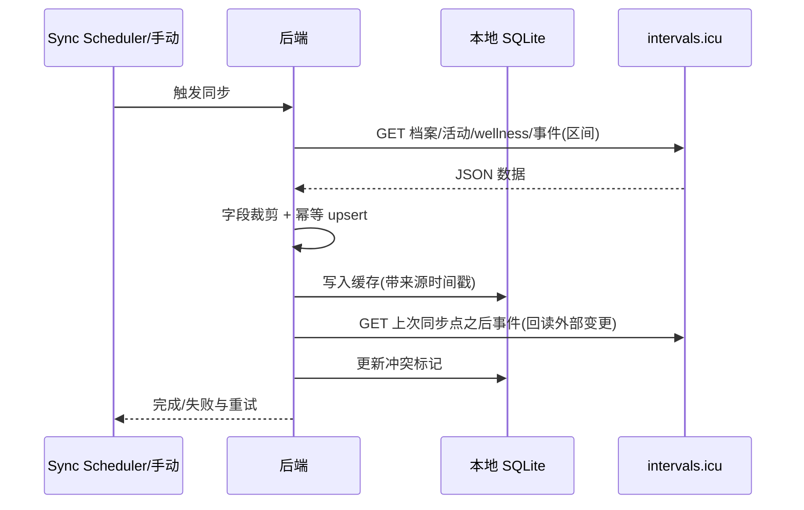
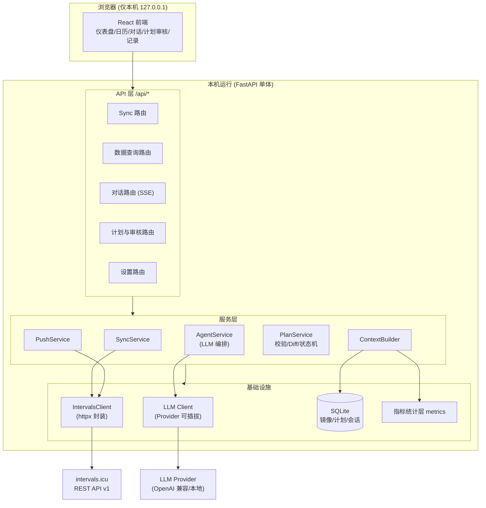
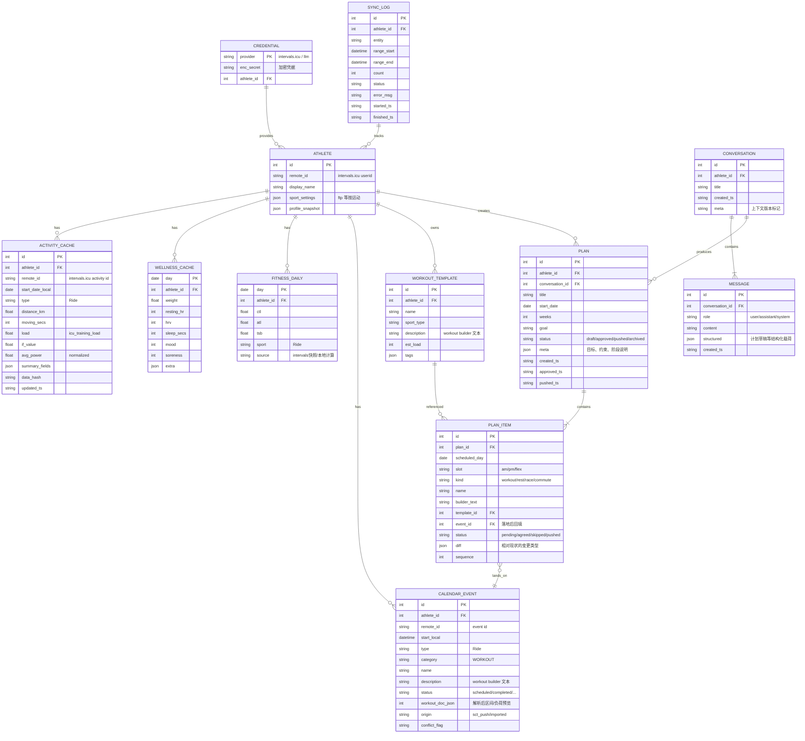
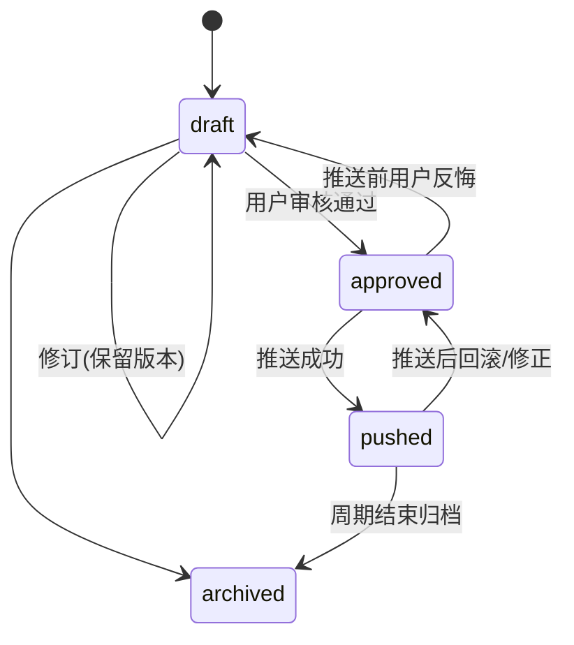

# SCT 系统化骑行训练系统 —— 系统设计文档

| 项目 | 内容 |
| --- | --- |
| 文档名称 | SystematicCyclingTrainingSystem（SCT）系统设计文档 |
| 版本 | v1.0 |
| 日期 | 2026-09-05 |
| 状态 | 评审稿 |
| 作者 | Alkaid |

> 本文档基于「本地单机 Web 应用 + LLM 为主的训练分析引擎 + Python/FastAPI 技术栈」的方向编写，覆盖系统概述、需求分析、非功能需求、架构、数据库、API、安全、性能、部署、扩展与实施计划，为后续开发提供技术指导。

---

## 目录

1. [系统概述](#1-系统概述)
2. [核心功能需求分析](#2-核心功能需求分析)
3. [非功能需求说明](#3-非功能需求说明)
4. [技术选型](#4-技术选型)
5. [系统架构设计](#5-系统架构设计)
6. [数据库设计](#6-数据库设计)
7. [API 接口规范](#7-api-接口规范)
8. [安全策略](#8-安全策略)
9. [性能要求与优化](#9-性能要求与优化)
10. [部署方案](#10-部署方案)
11. [扩展性规划](#11-扩展性规划)
12. [实施计划](#12-实施计划)
13. [附录](#13-附录)

---

## 1. 系统概述

### 1.1 背景与目标

骑行训练涉及大量指标（FTP、CTL/ATL/TSB、训练负荷、区间时间等），而这些数据分散沉淀在 [intervals.icu](https://intervals.icu/) 等平台中。运动员往往缺少一个「能读懂自身数据、并给出个性化训练计划」的助手。

SCT（SystematicCyclingTrainingSystem）的目标是：

1. 通过 intervals.icu 开放 API 拉取运动员数据（已完成训练、健康数据、日历计划、体能状态等）；
2. 以 **LLM 为主的分析引擎**，结合运动学指标解读数据，评估当前状态，并与用户对话共同制定/调整训练计划；
3. 训练计划一律采用 **intervals.icu Workout Builder 文本语法** 编写，保证在目标平台可直接落地；
4. 所有计划变更先由 **用户审核确认**，再通过 API 推回 intervals.icu；
5. 用户在 intervals.icu 中照常查看和执行计划；在 SCT 中统一查看、分析与回顾训练记录。

### 1.2 系统定位

- **形态**：本地单机 Web 应用。后端 + 前端 + 本地数据库均运行在同一台机器上，浏览器通过 `http://127.0.0.1:<port>` 访问。
- **数据权威端**：intervals.icu 是训练日历与记录的「事实来源」；SCT 不替代它，而是在其之上做分析与计划编排。
- **数据缓存**：本地 SQLite 缓存 intervals.icu 数据镜像，用于快速渲染、离线回顾以及为 LLM 构建上下文。
- **智能体角色**：SCT 内置一个「AI 训练伙伴」，以 LLM 为主要推理载体，通过结构化上下文 + 工具调用感知数据并产出分析与计划草案，用户在 Web 界面完成审核与确认。

### 1.3 设计原则

| 原则 | 说明 |
| --- | --- |
| 人机协同、变更可控 | 所有写回 intervals.icu 的变更都经过用户显式确认，并提供 Diff 预览 |
| 数据隐私优先 | 除 LLM 调用与数据同步外，不产生任何对外传输；本地数据可加密存储 |
| 单一事实来源 | 记录与日历以 intervals.icu 为准，本地仅作镜像/缓存 |
| 标准语法复用 | 计划落地的唯一编写语言是 intervals.icu Workout Builder 文本语法 |
| 可插拔 | LLM Provider、同步策略、存储均可替换，便于演进与离线化 |
| 简单可维护 | 单体后端 + 少量模块，避免过早分布式化 |

### 1.4 用户与角色

当前为**单用户**系统（本人，intervals.icu 账号 Alkaid / i93790），后续可平滑演化为多用户（见[扩展性规划](#11-扩展性规划)）。

| 角色 | 说明 | 权限 |
| --- | --- | --- |
| 运动员（Owner） | 本机唯一用户 | 全部功能 |
| AI 训练伙伴（LLM Agent） | 读取授权上下文、生成分析与计划草案 | 只读上下文；产出仅作为草案，无直接外发权限 |
| intervals.icu（外部系统） | 数据源与计划执行终端 | 通过 API Key 受限读写 |

### 1.5 系统边界

- **在 SCT 范围内**：拉取/缓存数据、指标统计、AI 对话、计划编排与审核、推送、记录浏览。
- **不在 SCT 范围内**：心率/功率原始流解析算法、平台自有训练日历的替代实现、真实设备数据采集（均由 intervals.icu 及其生态承担）。

---

## 2. 核心功能需求分析

### 2.1 功能架构总览



### 2.2 功能模块与用例

#### FR-1 数据接入与同步（Sync）

| 用例 | 说明 |
| --- | --- |
| FR-1.1 凭据配置 | 读取/录入 intervals.icu userid 与 API Key，校验连通性 |
| FR-1.2 手动同步 | 一键拉取：运动员档案、训练活动、健康（Wellness）、体能状态（CTL/ATL/TSB）、日历事件、功率曲线 |
| FR-1.3 增量同步 | 按日期区间增量拉取（newest > 上次同步点），幂等合并 |
| FR-1.4 事件回读 | 拉取 intervals.icu 日历上被用户（或 SCT）创建/修改过的事件，检测外部变更并提示冲突 |
| FR-1.5 同步状态 | 展示最近同步时间、各实体记录数、失败与重试状态 |

#### FR-2 训练数据分析（确定性统计层）

本地完成确定性的轻量指标汇总，作为 LLM 上下文的「结构化事实」：

- 时间段聚合：训练时长、距离、TSS/负荷（icu_training_load）、IF、平均/归一化功率、心率区间时间占比；
- 体能状态曲线：每日 CTL/ATL/TSB、短期趋势（如 7/42 天斜率）；
- 表现参照：FTP/eFTP、最大平均功率（功率曲线）、成绩变化；
- 健康侧：静息心率、HRV、睡眠、主观状态（soreness/fatigue/stress/mood）；
- 达标情况：实际完成 vs 计划负荷的比例、missed workout。

> 说明：intervals.icu 本身已提供 CTL/ATL/TSB 与负荷等计算结果，SCT 优先采用其快照值，避免重复造轮子；仅补充展示聚合与缺口分析。

#### FR-3 AI 训练伙伴（LLM 为主）

| 用例 | 说明 |
| --- | --- |
| FR-3.1 对话式分析 | 用户以自然语言提问（如「分析我最近两周的训练状态」），LLM 结合注入的上下文回答 |
| FR-3.2 计划生成 | 用户表达目标（如备赛、提 FTP、控量恢复），LLM 产出**结构化周计划草案**（JSON），每节训练附 Workout Builder 文本 |
| FR-3.3 计划调整 | 基于执行反馈（完成度、主观状态、突发情况）对话式修订草案 |
| FR-3.4 上下文构建 | 将档案、最近活动摘要、状态趋势、目标与约束组装为受限 Prompt + 工具调用，控制 Token 与隐私 |
| FR-3.5 输出约束 | 通过 Pydantic Schema + JSON Mode/Function Calling 强制结构化输出；Workout Builder 文本附本地语法预检 |
| FR-3.6 Provider 可插拔 | OpenAI 兼容 Chat Completions（兼容国内服务商），亦支持本地 Ollama/兼容端点 |

#### FR-4 计划编排与审核确认

| 用例 | 说明 |
| --- | --- |
| FR-4.1 草案管理 | 计划草案（目标、周期、每周安排）保存为 `draft`，可多次修订，每次修订保留版本记录 |
| FR-4.2 Diff 预览 | 与「当前 intervals.icu 日历状态」对比：新增/修改/删除事件一目了然 |
| FR-4.3 单条/批量审核 | 用户逐条同意或调整（改日期、时长、强度模板），确认后状态置为 `approved` |
| FR-4.4 推送落地 | 将 approved 变更写入 intervals.icu（新建/更新/删除事件），记录远端 eventId 与推送结果 |
| FR-4.5 冲突处理 | 目标时段已有非本系统创建的事件时提示，由用户决定覆盖或跳过 |

#### FR-5 训练记录浏览与管理

| 用例 | 说明 |
| --- | --- |
| FR-5.1 日历视图 | 月/周日历展示计划事件与实际活动完成对照 |
| FR-5.2 列表与筛选 | 按日期/类型/负荷/强度筛选活动与健康记录 |
| FR-5.3 详情下钻 | 单条活动概览、区间统计、负荷与 RPE 等（不存储原始流，按需回源或跳转 intervals.icu） |
| FR-5.4 图表 | CTL/ATL/TSB 曲线、周负荷柱状、区间时间分布、主观状态时间线 |

#### FR-6 设置与健康管理

- LLM Provider 配置（base_url / model / api_key / 温度等）；
- intervals.icu 凭据管理（加密存储）；
- 同步范围（历史回看天数、默认计划展望周数）；
- 数据清理与备份入口。

### 2.3 核心流程

#### 2.3.1 AI 计划生成 → 审核 → 推送



#### 2.3.2 数据同步闭环



---

## 3. 非功能需求说明

### 3.1 性能（Performance）

| 编号 | 指标 | 目标 |
| --- | --- | --- |
| NFR-P1 | 常规页面首屏 | 本地环境 ≤ 1s（读缓存，不触发远端） |
| NFR-P2 | 90 天数据同步 | ≤ 60s（含 intervals.icu 限速退避） |
| NFR-P3 | 日历/列表查询 | 典型区间查询 ≤ 300ms |
| NFR-P4 | LLM 首 token | 由 Provider 决定；前端必须**流式输出**避免等待感知 |
| NFR-P5 | 并发 | 单用户场景支持浏览器多标签并发请求；写操作串行化 |

### 3.2 可靠性与可用性（Reliability）

- 同步具备**断点续传**：记录每个实体的 `last_sync_time`，失败自动重试（指数退避，尊重 API 429）。
- intervals.icu 不可用时，系统仍可基于缓存完成浏览；写操作进入「待推送队列/失败清单」可手动重试。
- 每次推送**幂等**：以本地 `remote_event_id` + 内容 hash 判断，避免重复创建。
- 数据库文件定期自动备份到备份目录，保留最近 N 份。

### 3.3 可维护性（Maintainability）

- 后端分层：`routes / service / repository(store) / api-client(external) / llm / schemas`；
- 外部集成（intervals.icu、LLM Provider）全部收敛为可替换的 client 接口，便于 mock 测试；
- 统一日志（结构化 JSON 行）、统一错误码与异常处理；
- SQLite 表变更用轻量 migration（如 `alembic` 或启动期 schema 版本表）。

### 3.4 安全性（Security）

详见[第 8 章](#8-安全策略)。要点：本地仅绑定 127.0.0.1、凭据加密存储、LLM 外发最小化、操作审计日志。

### 3.5 兼容性（Compatibility）

- 浏览器：近 2 年 Chrome / Edge / Firefox / Safari 桌面版；
- 操作系统：Windows（首发），代码保持跨平台以兼容 macOS/Linux；
- intervals.icu API：固定基线版本，客户端做字段级容错（宽松解析 + 字段裁剪）。

---

## 4. 技术选型

### 4.1 选型总表

| 层次 | 选型 | 版本基线 | 理由 |
| --- | --- | --- | --- |
| 后端框架 | Python + FastAPI | Python 3.11+ / FastAPI 0.11x | 类型安全、异步、自动 OpenAPI 文档，贴合运动数据分析生态 |
| API 模型 | Pydantic v2 | v2 | Schema 校验 + 结构化输出校验 |
| 本地数据库 | SQLite（内置 `sqlite3` / SQLAlchemy） | SQLAlchemy 2.x | 单机零运维，事务完备；预留 PostgreSQL 迁移路径 |
| ORM/迁移 | SQLAlchemy + Alembic | 2.x | 声明式模型与轻量迁移 |
| HTTP 客户端 | httpx | 1.x | async、支持流式（SSE）、重试友好 |
| 定时任务 | APScheduler（可选后台常驻） | 3.x | 周期增量同步、本地提醒 |
| LLM 客户端 | OpenAI SDK（兼容模式）/ 自封装 | — | 统一 Chat Completions 协议，兼容 OpenAI/DeepSeek/Qwen/本地 Ollama |
| 前端框架 | React + TypeScript + Vite | React 18/19 | 组件化、生态成熟 |
| UI 组件 | Ant Design（图表用 ECharts/Recharts） | — | 表格、日历、Diff、表单效率高 |
| 状态/请求 | TanStack Query + axios/fetch | — | 服务端状态缓存、SSE 流支持 |
| 测试 | pytest + pytest-asyncio / vitest+Testing Library | — | 后端单测与前端组件测试 |
| 静态检查 | Ruff / ESLint+Prettier | — | 代码质量 |
| 打包运行 | 一键脚本 + `.venv`；前端产物由 FastAPI 静态托管 | — | 本地体验即开即用 |

### 4.2 关键架构决策（ADR 摘要）

| 决策 | 选择 | 原因 |
| --- | --- | --- |
| LLM 为主的分析 | 数据事实 = 确定性统计层注入；结论/叙事/计划拟定 = LLM | 兼顾可靠数字与灵活解释，符合用户确认的方案 |
| Workout 文本为唯一编写语言 | 生成/编辑/存储均使用 intervals.icu Workout Builder 语法 | 保证跨平台直接执行、解析负荷一致 |
| 本地缓存镜像 | SQLite 镜像 + 时间戳；原始流文件不入库 | 控制体积，满足快速渲染与上下文构建 |
| 写回前强制审核 | draft→approved→pushed 状态机 | 变更可控（核心产品约束） |
| 单一用户 | 无账号体系，绑定 127.0.0.1 | 最小实现；后续按[扩展性规划](#11-扩展性规划)演进 |

---

## 5. 系统架构设计

### 5.1 总体架构图



### 5.2 分层说明

| 层 | 职责 | 关键约束 |
| --- | --- | --- |
| 前端层 | 渲染与交互：仪表盘、日历、对话、计划 Diff/审核 | 不直连 intervals.icu 与 LLM，全部走本机 `/api` |
| API 层 | REST 路由、参数/鉴权（本机 token）、SSE 流 | 薄路由，只做编排 |
| 服务层 | 同步、上下文构建、Agent、计划校验、推送 | 业务规则与状态机所在 |
| 基础设施层 | 外部 client、SQLite、统计函数 | 唯一对外网络出口（intervals.icu / LLM） |

### 5.3 后端目录结构（规划）

```
sct/
├─ app/
│  ├─ main.py                  # FastAPI 实例、静态资源挂载
│  ├─ config.py                # 本地配置(pydantic-settings)
│  ├─ api/                     # 路由层
│  ├─ services/                # sync/context/agent/plan/push/metrics
│  ├─ integrations/            # intervals 客户端、llm 客户端
│  ├─ store/                   # sqlite 仓储 + alembic
│  ├─ models/                  # ORM 模型
│  ├─ schemas/                 # Pydantic 请求/响应
│  └─ utils/                   # 日志、加密、重试
├─ web/                        # React + Vite 前端源码
├─ data/                       # 运行数据目录(sct.db、备份)
├─ scripts/                    # 一键启动/备份/导入凭据
└─ tests/
```

---

## 6. 数据库设计

### 6.1 设计原则

- 本地 SQLite，`WAL` 模式；
- 镜像表与 intervals.icu 记录保持 `remote_id` + `data_hash + updated_ts`，幂等 upsert；
- 计划/对话/审核等业务表为主表；
- 关键查询字段建索引（日期、类型、remote_id、status、athlete_ref）；
- 不存储原始流数据与大字段，活动只存摘要列。

### 6.2 ER 概览



### 6.3 核心表结构

#### credential（凭据表）

| 字段 | 类型 | 说明 |
| --- | --- | --- |
| id | INTEGER PK | |
| provider | TEXT | `intervals_icu` / `llm` |
| name | TEXT | 展示名（如 openai-compatible / ollama） |
| enc_secret | TEXT | 加密后的 API Key（AES-GCM，密钥来自本机配置） |
| extra | TEXT(JSON) | base_url、model、userid 等非密钥参数 |
| enabled | INT | 是否启用 |
| created_ts / updated_ts | TEXT | |

#### athlete（运动员档案镜像）

| 字段 | 类型 | 说明 |
| --- | --- | --- |
| id | INTEGER PK | |
| remote_id | TEXT UNIQUE | intervals.icu userid（如 `i93790`） |
| display_name | TEXT | |
| sport_settings | TEXT(JSON) | 每运动 FTP/LTHR/体重等 |
| profile_snapshot | TEXT(JSON) | 最后一次 profile 快照 |
| last_synced_ts | TEXT | |

#### activity_cache / wellness_cache / fitness_daily

对应 6.2 ER 图字段，`athlete_id + 日期` 建联合唯一索引；活动以 `remote_id` 唯一。`data_hash` 用内容摘要，同步时 `hash 相同则跳过写`，实现幂等。

#### calendar_event

| 字段 | 类型 | 说明 |
| --- | --- | --- |
| id | INTEGER PK | |
| athlete_id | INTEGER FK | |
| remote_id | TEXT | intervals.icu event id（推送后回填） |
| start_local | DATETIME | 事件本地开始时间（ISO-8601） |
| type | TEXT | Ride 等运动类型 |
| category | TEXT | WORKOUT 等 |
| name | TEXT | |
| description | TEXT | **Workout Builder 文本**，落地核心字段 |
| parsed_load / parsed_intensity / workout_doc | TEXT(JSON) | 推送后由 intervals.icu 解析结果回填，用于审核预览 |
| origin | TEXT | `imported`(回读自日历) / `sct_push` |
| conflict_flag | INT | 本系统事件与外部改动冲突提示 |

#### plan / plan_item

计划与计划条目（见 ER）。状态机：



#### conversation / message

对话与会话消息。消息的 `structured` 字段承载 LLM 结构化产物（计划草稿、分析要点），便于前端渲染与可追溯。

#### 辅助表

- `sync_log`：同步历史；
- `app_kv`：键值配置（同步游标、UI 偏好等）；
- `audit_log`：关键操作（审核、推送、删除、配置变更）。

### 6.4 数据保留与清理

- 活动/健康缓存保留可配置（默认 3 年），超期归档；
- workout_doc 解析结果超过 30 天可重建（description 常驻）；
- 对话消息默认全保留（本地容量小），提供「清空旧对话」入口。

---

## 7. API 接口规范

### 7.1 总体约定

- Base URL：`http://127.0.0.1:<port>/api`
- 风格：RESTful JSON；`application/json`；
- 认证：本机服务启动生成一次性的访问 token（见 8.2），请求头 `Authorization: Bearer <token>`；
- 时间：ISO-8601（含本地时区偏移），intervals.icu 使用本地日期 `YYYY-MM-DD`；
- 统一响应错误：

```json
{ "error": { "code": "SYNC_FAILED", "message": "…", "detail": {} } }
```

- 常见 HTTP 状态：`200/201/204/400/401/404/409(冲突)/422(校验失败)/429/500/502(上游)`。

### 7.2 内部 API 清单（前端 ↔ SCT 后端）

| 方法 | 路径 | 说明 |
| --- | --- | --- |
| GET | /api/settings | 读系统与同步配置 |
| PUT | /api/settings | 更新配置 |
| POST | /api/settings/credentials/test | 凭据连通性测试 |
| GET | /api/athlete | 档案（含各运动 FTP） |
| POST | /api/sync | 触发同步（body: entities, date range） |
| GET | /api/sync/status | 最近同步状态 |
| GET | /api/activities | 活动列表（时间/类型/负荷筛选、分页） |
| GET | /api/activities/{id} | 活动详情 |
| GET | /api/wellness | 健康时间线 |
| GET | /api/fitness | CTL/ATL/TSB 曲线数据 |
| GET | /api/events | 日历事件（本地镜像） |
| GET | /api/metrics/summary | 时间段汇总指标 |
| GET/POST | /api/conversations | 会话列表/新建 |
| GET | /api/conversations/{id}/messages | 消息历史 |
| POST | /api/chat/stream | **SSE**：对话消息，支持工具型动作（生成计划等） |
| POST | /api/plans/generate | 基于对话上下文生成计划草案 |
| GET | /api/plans | 计划列表 |
| GET | /api/plans/{id} | 计划详情（含 items + diff） |
| PATCH | /api/plans/{id} | 修订计划/计划项 |
| POST | /api/plans/{id}/approve | 通过审核（状态→approved） |
| POST | /api/plans/{id}/push | 推送至 intervals.icu（状态→pushed） |
| POST | /api/plans/{id}/rollback | 回滚已推送变更 |
| GET/POST/PUT/DELETE | /api/workout-templates | 训练模板库 |
| GET | /api/audit | 审计日志 |

### 7.3 关键接口示例

#### 7.3.1 生成计划草案

```http
POST /api/plans/generate
Authorization: Bearer <token>
Content-Type: application/json
```

```json
{
  "conversation_id": 12,
  "start_date": "2026-09-07",
  "weeks": 1,
  "goal": "提升 FTP：4 周过渡期后的第一周",
  "constraints": ["周二/周四只能晚训，时间≤90分钟", "周日下午长途可用"]
}
```

响应（draft）：

```json
{
  "plan_id": 31,
  "status": "draft",
  "weeks": [{ "week_start": "2026-09-07", "days": [
    { "day": "2026-09-07", "slot": "pm", "kind": "workout",
      "name": "SST 2x20",
      "builder_text": "Warmup\n- 15m ramp 50-75% 90rpm\n\nMain Set 2x\n- 20m 90% 90-95rpm\n- 5m 50% 85rpm\n\nCooldown\n- 10m ramp 75-50% 85rpm",
      "diff": { "type": "create" } }
  ]}],
  "warnings": ["周一为强度日，前 7 天 TSB 已低于 -15，建议首日强度下调 5%"]
}
```

#### 7.3.2 审核通过

```http
POST /api/plans/31/approve
```

```json
{ "items": [ { "id": 1001, "agreed": true }, { "id": 1002, "agreed": true } ] }
```

#### 7.3.3 推送

```http
POST /api/plans/31/push
```

响应：每条 item 落地结果，回填 `event_id`、解析负荷：

```json
{ "results": [ { "item_id": 1001, "ok": true, "event_id": 610062,
  "parsed_load": 116, "intensity": 86.0 } ] }
```

#### 7.3.4 SSE 对话（节选）

```text
POST /api/chat/stream
Accept: text/event-stream
{"conversation_id": 12, "content": "帮我看看这周状态，是否需要减载？"}
```

```text
event: token   data: {"t": "…"}
event: tool    data: {"name": "query_fitness", "ok": true}
event: final   data: {"message_id": 501, "structured": {…}}
```

### 7.4 与 intervals.icu 外部 API 的映射

> Base：`https://intervals.icu/api/v1`。认证方式以官方文档为准（本系统后端统一在 `IntervalsClient` 收敛，便于切换 Basic/API-Key Header）。`{id}` 可传 `0` 表示「由 API Key 解析的本人」。

| SCT 操作 | intervals.icu 调用 | 说明 |
| --- | --- | --- |
| 校验凭据/拉档案 | `GET /athlete/{id}`、`GET /athlete/{id}/profile` | 档案含各运动 FTP 设置 |
| 同步活动 | `GET /athlete/{id}/activities?oldest=&newest=&fields=` | 用 `fields` 裁剪字段，避免超大响应 |
| 活动详情 | `GET /activity/{id}?intervals=true` | 需下钻时按需调用 |
| 同步健康 | `GET /athlete/{id}/wellness.json?oldest=&newest=&fields=` | 返回含 CTL/ATL 等计算字段 |
| 体能曲线 | `GET /athlete/{id}/fitness.json?…` / wellness 计算列 | CTL/ATL/TSB 快照 |
| 功率曲线 | `GET /athlete/{id}/power-curves.json?type=Ride&curves=1y,42d,all` | 表现参照 |
| 回读日历 | `GET /athlete/{id}/events?oldest=&newest=` | 事件含 description/workout_doc |
| 新建事件 | `POST /athlete/{id}/events` | `{category:"WORKOUT", type, start_date_local, name, description}`，description 即 Workout Builder 文本；响应含解析后 load/intensity |
| 更新/删除事件 | `PUT|DELETE /athlete/{id}/events/{eventId}` | 计划修订/回滚 |
| 拉取模板(可选) | `GET /athlete/{id}/folders` | 读取已有训练库文本作为生成参考 |

**一致性策略**：推送后立即回读一次事件，用解析后的 `workout_doc / icu_training_load` 覆盖本地 preview；周期同步再次回读，如远端事件时间/内容被用户改动且非本系统写入，置 `conflict_flag`。

### 7.5 Workout Builder 文本语法约定（生成约束）

在 `plan_item.builder_text` 中必须遵守 intervals.icu Workout Builder 规则，核心约束（详见[语法速查](https://forum.intervals.icu/t/workout-builder-syntax-quick-guide/123701)）：

1. 步骤行以 `- ` 开头：`- [时长或距离] [目标强度] [可选踏频]`；
2. 时长：`1h / 5m / 30s / 5m30s`（注意 `m=分钟`，米用 `mtr`）；距离：`500mtr/2km/10mi`；
3. 功率目标：FTP 百分比 `85%`、范围 `90-105%`、绝对功率 `220w`、区间 `Z2`、`ramp 50-75%`；
4. 心率目标：`70% HR`、`Z3 HR` 等（仅当用户习惯以心率控强度时使用）；
5. 段落标题（Warmup/Main Set/Cooldown）独立成行；重复组 `Main Set 4x` 或单独 `4x` 行，前后空行；
6. 允许 markdown 标题/表格作为阅读性注释，解析时会忽略；
7. 本地做**语法预检**（最小规则集），最终以 intervals.icu 解析结果（workout_doc、icu_training_load）为权威，并把解析预览回显到审核界面。

---

## 8. 安全策略

### 8.1 凭据与敏感配置

| 凭据 | 存储方式 |
| --- | --- |
| intervals.icu userid / API Key | 加密存储于 `credential` 表（AES-GCM，密钥取本机密钥环或 `data/.secret`，权限 600） |
| LLM Provider API Key | 同上 |
| 现有 `userinfo.json` | 作为**首次导入源**：启动时读入 → 迁移进加密库 → 提示用户移出版本库/删除明文 |

> ⚠️ 提醒：`userinfo.json` 目前以明文保存 API Key，若项目纳入 Git，务必加入 `.gitignore`，避免泄露。

### 8.2 本地服务访问控制

- 服务只监听 `127.0.0.1`，拒绝外部网卡绑定；
- 首次启动生成随机访问 token，持久化到 `data/`，前端通过本地回环读取；避免 CSRF：校验 `Origin/Host` + Bearer token；
- 会话 cookie 置 `SameSite=Strict`、无第三方域名场景；
- 若用户主动开启局域网访问（高级选项），必须显式二次确认并改为强密码认证，默认关闭。

### 8.3 数据隐私与 LLM 外发

- 默认**最小化外发**：发往 LLM 的内容仅包含「上下文构建器」组装的结构化摘要，不发送原始流文件与批量原始记录；
- 首次使用 LLM 前展示隐私说明，用户可选择本地模型（Ollama/兼容端点）实现零外发；
- Prompt 中可注入「脱敏偏好」（如隐藏活动名称、位置类字段一律不采集）；
- 输出落库前过滤敏感回显（如 API Key 不得出现在对话/日志）。

### 8.4 操作审计与写入安全

- 关键操作（审核通过、推送、删除、凭据变更）写 `audit_log`（操作者、动作、对象、时间、结果）；
- 所有对 intervals.icu 的写操作仅在 `pushed` 语义下进行，且每次推送前二次 Diff 展示；
- API Key 权限最小化：仅使用 intervals.icu 所需读/写范围，不申请无关权限。

### 8.5 备份与恢复

- `scripts/backup.py`：停止写入点导出 `sct.db`（WAL checkpoint）+ 配置，压缩加密存储；
- 保留最近 7 份自动备份；提供 `restore` 子命令；
- 导出文件不包含明文密钥（加密凭据随库导出但受主密钥保护）。

---

## 9. 性能要求与优化

### 9.1 同步性能

- 增量游标：每个实体记录 `last_sync_time`，默认只拉增量（newest 上限 = 上次游标），历史首次全量可分页；
- 字段裁剪：始终使用 `fields`/`cols` 只取所需列（活动列表不取流）；
- 限速友好：令牌桶 ~≤10 req/s（对齐上游），429/5xx 指数退避 + 断点重试；
- 大区间拆分为小窗口（如按周）并发拉取但串行写库。

### 9.2 查询性能

- SQLite 索引：`activity_cache(athlete_id,start_date_local)`、`calendar_event(athlete_id,start_local)`、`fitness_daily(athlete_id,day)` 等；
- 常用聚合（周负荷、区间占比）提供物化视图式汇总表 `metrics_daily`，由同步后增量更新；
- 列表接口默认分页 `limit/offset` 或游标。

### 9.3 LLM 交互性能

- 上下文构建按预算裁剪（如近 14 天活动摘要 + 90 天状态趋势 + 本周日历），避免超长 Prompt；
- 对话采用 **SSE 流式**输出，首屏即时反馈；
- 结构化结果（计划草案）返回后本地立即校验，错误则引导 LLM 重试（最多 2 次）或提示用户调整；
- 对高频只读指标查询做短 TTL 缓存（如 10s）。

### 9.4 前端性能

- 图表数据懒加载（进入视图才请求）；
- ECharts 按需引入；打包产物 gzip；
- 大列表虚拟滚动。

---

## 10. 部署方案

### 10.1 本地部署形态

```
浏览器 ──HTTP 127.0.0.1:8787──▶ FastAPI(uvicorn) ──▶ SQLite(data/sct.db)
                                      │
                                      ├──▶ intervals.icu (HTTPS 出站)
                                      └──▶ LLM Provider (HTTPS 出站)
```

- 前端构建产物（`web/dist`）由 FastAPI 静态托管，**一个进程即完整应用**；
- 开发模式：Vite dev server 代理 `/api` 到后端，热更新；
- 进程管理器：Windows 提供 `.bat`/任务计划；也可用 `uvicorn` 常驻。

### 10.2 一键启动（规划）

```bash
# Windows (PowerShell)
.\scripts\start.ps1        # 检查/创建 .venv → pip install → 首次导入 userinfo.json → 启动

# 通用
uv run python -m sct       # 或 uvicorn app.main:app --host 127.0.0.1 --port 8787
```

### 10.3 配置与环境变量

```env
SCT_HOST=127.0.0.1
SCT_PORT=8787
SCT_DATA_DIR=./data
SCT_SECRET_FILE=./data/.secret     # 加密主密钥(600)
SCT_SYNC_LOOKBACK_DAYS=1095        # 首次同步历史
SCT_LLM_PROVIDER=openai_compatible # 或 ollama/local
SCT_LLM_BASE_URL=…                # 由 /api/settings 管理
SCT_LLM_MODEL=…
```

### 10.4 升级与迁移

- Alembic 版本化迁移：`alembic upgrade head` 于启动前自动执行；
- 备份目录 `data/backups/`；升级前自动快照；
- 前端产物与后端版本绑定发布，保证 API 匹配。

---

## 11. 扩展性规划

| 演进方向 | 触发条件/价值 | 影响面 | 落地要点 |
| --- | --- | --- | --- |
| 多用户化 | 分享给他人/教练协作 | 中 | 引入用户表与认证；intervals.icu 采用 OAuth Bearer 授权流（参考其 OAuth 文档）替代共享 API Key |
| 多运动支持 | 跑步/游泳纳入 | 中 | 运动类型字段化、模板按 sport_type 组织、pace 目标语法启用 |
| 更多数据源 | Strava/Garmin/TP 直连 | 低-中 | 抽象 `DataSourceAdapter`，镜像表语义不变 |
| 自动定时同步 | 开机常驻体验 | 低 | APScheduler + 开机自启 |
| 本地模型默认化 | 隐私优先场景 | 低 | LLM Provider 默认指向本地 Ollama |
| 训练库/模板分享 | 社区化 | 中 | workout_template 增加导入导出 |
| 移动端轻浏览 | 通勤查看当日课表 | 中 | 复用 API + 只读 PWA |
| 规则引擎兜底 | 无 LLM 时的确定性计划 | 中 | 计划服务抽象出 `PlanGenerator` 接口，规则引擎为第二实现 |
| 私有化 Web 部署 | 迁移服务器 | 低 | SQLite→PostgreSQL、静态资源走 CDN/反代、HTTPS |

架构层面预留的关键扩展点：`IntervalsClient`、`LLMClient`、`PlanGenerator`、`Store` 四个接口，均以可替换实现收敛。

---

## 12. 实施计划

> 以**里程碑 + 任务**拆解；每阶段含可验收产物。

### M1 地基与数据链路（对应 FR-1、NFR）

| 任务 | 交付物 | 验收标准 |
| --- | --- | --- |
| 工程脚手架 | FastAPI + 前端 + SQLite + 迁移 | 一条命令本地起服务 |
| IntervalsClient | 凭据测试、档案/活动/wellness/events 拉取 | 用真实账号同步 90 天数据无错、限速退避生效 |
| 缓存模型与同步 | activity/wellness/fitness/event 幂等 upsert + sync_log | 重复同步结果一致、断点续传可用 |
| 设置与凭据加密 | /api/settings、加密存储、userinfo.json 导入迁移 | 明文 Key 可被导入并加密，页面不回显明文 |

### M2 可视化与统计（对应 FR-2、FR-5）

| 任务 | 交付物 | 验收标准 |
| --- | --- | --- |
| 日历 + 活动列表/详情 | 前端页面 | 90 天数据渲染 < 1s |
| 体能/负荷图表 | CTL/ATL/TSB、周负荷、区间分布 | 与 intervals.icu 站点数值一致(±1%) |
| 指标汇总接口 | /api/metrics/summary | 输出稳定结构供上下文构建复用 |

### M3 AI 分析对话（对应 FR-3）

| 任务 | 交付物 | 验收标准 |
| --- | --- | --- |
| LLM Client 抽象 | OpenAI 兼容 + Ollama 双 Provider | 两 Provider 切换可用 |
| 上下文构建器 | 受控上下文（档案+近 14 天+90 天趋势+日历） | 输出 Token 预算内、字段有界 |
| 对话 SSE | 会话/消息持久化 + 流式 | 打字机输出，中断可恢复 |
| 结构化产出 | 分析结论/计划草案 Schema + 校验 | 非法输出可拦截并重试 |

### M4 计划编排与写回（对应 FR-4，产品核心）

| 任务 | 交付物 | 验收标准 |
| --- | --- | --- |
| 计划状态机与修订 | plan/plan_item + diff 计算 | 增删改 Diff 正确、状态流转受控 |
| 审核界面 | 逐条同意/修改 + 预览解析负荷 | 未同意项绝不推送 |
| PushService | 事件创建/更新/删除 + 幂等 | 与 intervals.icu 日历最终一致，重复推送不产生重复事件 |
| 回读与冲突 | push 后回读 + conflict 标记 | 外部改动可被识别提示 |

### M5 打磨与加固（对应 NFR、安全、性能）

| 任务 | 交付物 | 验收标准 |
| --- | --- | --- |
| 安全加固 | 仅 127.0.0.1、token/CSRF、审计、密钥环 | 通过自查清单 |
| 性能优化 | 索引、汇总表、流式、缓存 | 达成 §9 指标 |
| 备份与恢复 | backup/restore 脚本 | 恢复演练通过 |
| 测试与文档 | pytest/vitest 用例、README、用户手册 | 核心流程自动化测试覆盖 |
| 端到端验收 | 真实账号走通「对话→生成→审核→推送→回读」闭环 | 全流程无人工干预错误 |

### 里程碑风险表

| 风险 | 等级 | 缓解 |
| --- | --- | --- |
| intervals.icu API 字段变化 | 中 | 客户端字段级容错 + 定期回归联调 |
| LLM 输出不符合语法/意图 | 中 | Schema 强校验 + 本地语法预检 + 解析预览回显 + 有限重试 |
| 误推送/误删远端事件 | 高 | 强制审核 + Diff + 回滚接口 + 审计日志 + 前端二次确认 |
| 上游限速/偶发 5xx | 低 | 令牌桶 + 退避 + 断点续传 |
| 本机数据丢失 | 低 | WAL + 自动备份 + 恢复脚本 |
| 隐私顾虑（数据外发 LLM） | 中 | 默认最小化外发、支持本地模型、脱敏偏好 |

---

## 13. 附录

### 13.1 参考资料

- [Intervals.icu Open API 特性页](https://intervals.icu/features/open-api/)
- [API 集成 Cookbook（论坛）](https://forum.intervals.icu/t/intervals-icu-api-integration-cookbook/80090)
- [API 条款与条件](https://forum.intervals.icu/t/intervals-icu-api-terms-and-conditions/114087)
- [API 访问（论坛主帖，含端到端示例）](https://forum.intervals.icu/t/api-access-to-intervals-icu/609)
- [Workout Builder 功能帖](https://forum.intervals.icu/t/workout-builder/1163)
- [Workout Builder 语法速查](https://forum.intervals.icu/t/workout-builder-syntax-quick-guide/123701)

### 13.2 术语表

| 术语 | 说明 |
| --- | --- |
| FTP | Functional Threshold Power，功能阈值功率 |
| eFTP | intervals.icu 估算的当前 FTP |
| CTL / ATL / TSB | 长期/短期训练负荷（Chronic/Acute Training Load）与状态差（Form = CTL − ATL） |
| TSS / 负荷 | 训练压力分；intervals.icu 侧对应 `icu_training_load` |
| IF | Intensity Factor 强度系数 |
| Workout Builder 文本 | intervals.icu 训练课描述语法（本文 §7.5） |
| Wellness | 每日健康记录（体重、静息心率、HRV、睡眠、主观状态等） |
| EVENT | intervals.icu 日历上的计划事件（类别 WORKOUT 等） |
