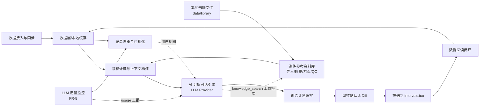
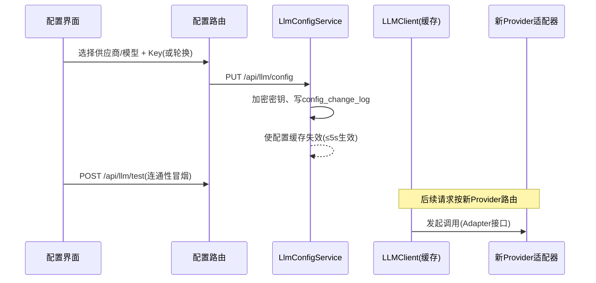
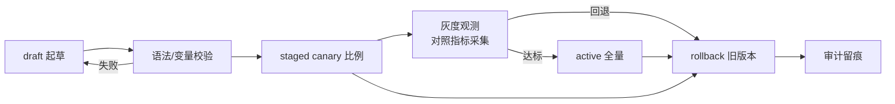
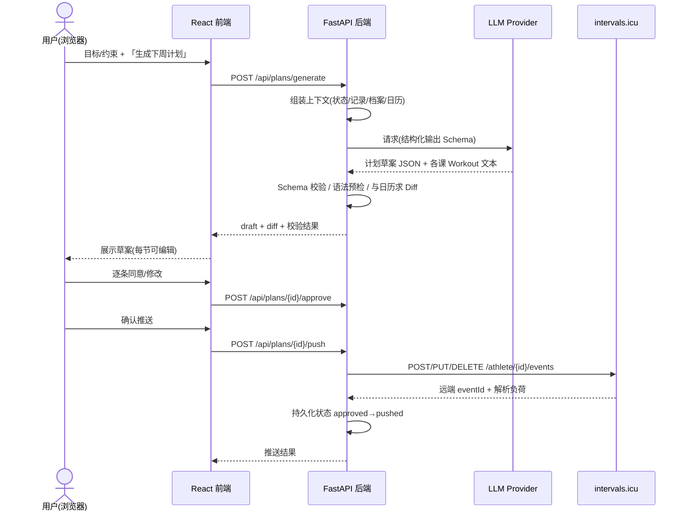
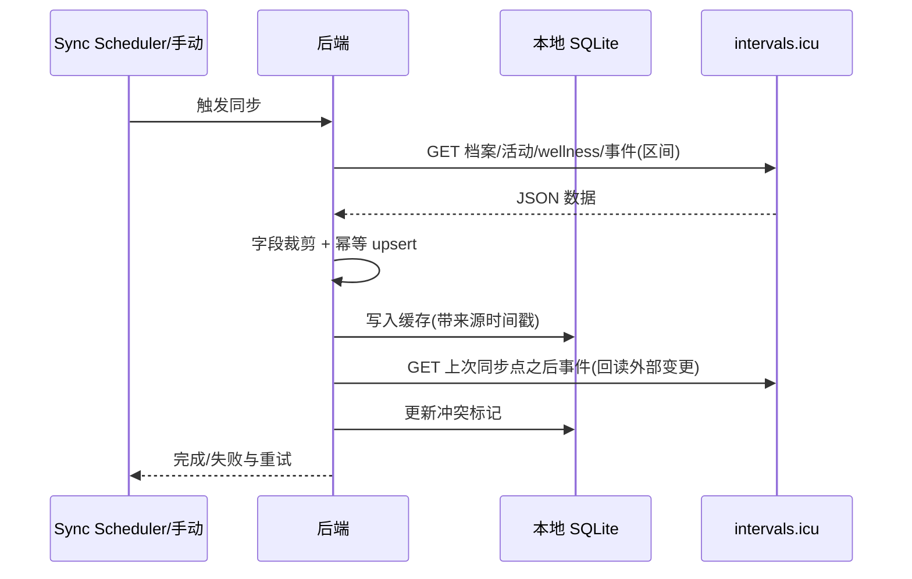
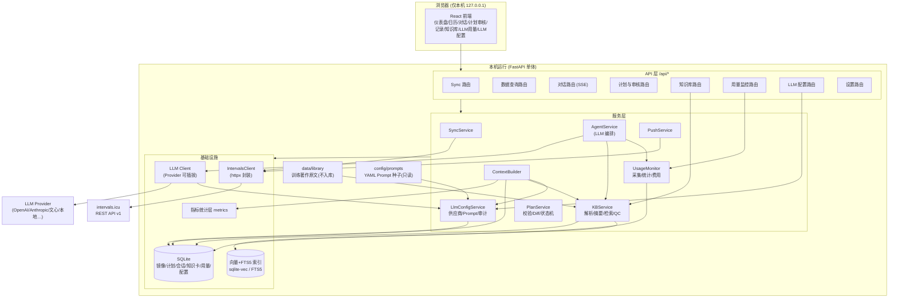
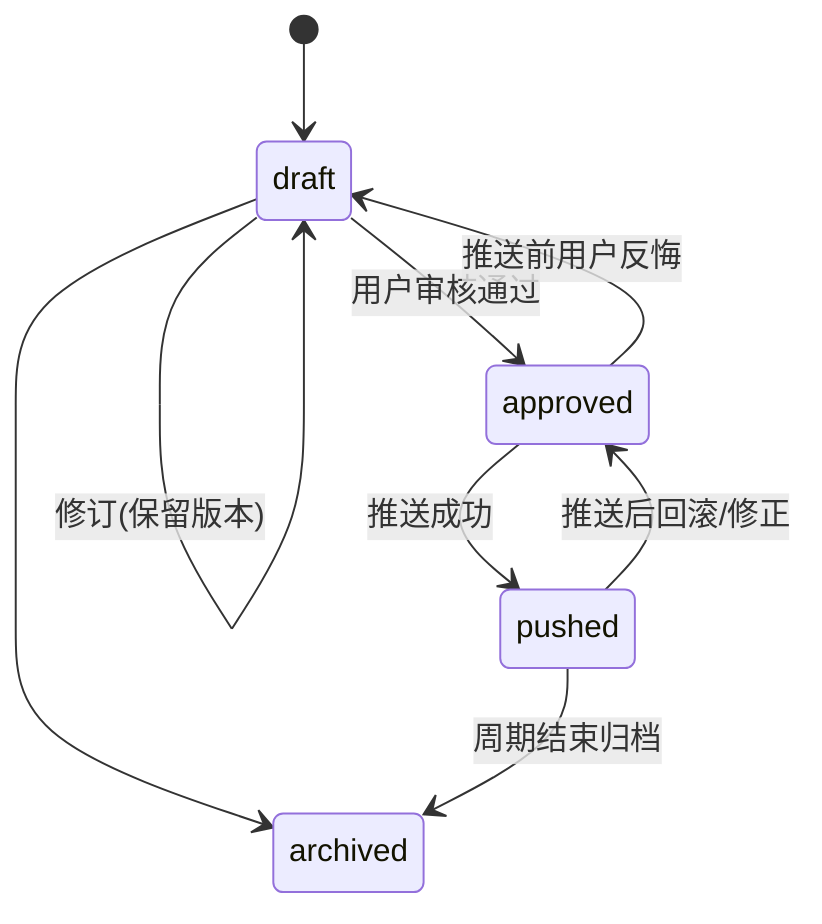

# SCT 系统化骑行训练系统 —— 系统设计文档

| 项目 | 内容 |
| --- | --- |
| 文档名称 | SystematicCyclingTrainingSystem（SCT）系统设计文档 |
| 版本 | v1.0 |
| 日期 | 2026-09-05 |
| 状态 | 评审稿 |
| 作者 | Alkaid |

> 本文档基于「本地单机 Web 应用 + LLM 为主的训练分析引擎 + Python/FastAPI 技术栈」的方向编写，覆盖系统概述、需求分析、非功能需求、架构、数据库、API、安全、性能、部署、扩展与实施计划，为后续开发提供技术指导。

---

## 目录

1. [系统概述](#1-系统概述)
2. [核心功能需求分析](#2-核心功能需求分析)
3. [非功能需求说明](#3-非功能需求说明)
4. [技术选型](#4-技术选型)
5. [系统架构设计](#5-系统架构设计)
6. [数据库设计](#6-数据库设计)
7. [API 接口规范](#7-api-接口规范)
8. [安全策略](#8-安全策略)
9. [性能要求与优化](#9-性能要求与优化)
10. [部署方案](#10-部署方案)
11. [扩展性规划](#11-扩展性规划)
12. [实施计划](#12-实施计划)
13. [附录](#13-附录)

---

## 1. 系统概述

### 1.1 背景与目标

骑行训练涉及大量指标（FTP、CTL/ATL/TSB、训练负荷、区间时间等），而这些数据分散沉淀在 [intervals.icu](https://intervals.icu/) 等平台中。运动员往往缺少一个「能读懂自身数据、并给出个性化训练计划」的助手。

SCT（SystematicCyclingTrainingSystem）的目标是：

1. 通过 intervals.icu 开放 API 拉取运动员数据（已完成训练、健康数据、日历计划、体能状态等）；
2. 以 **LLM 为主的分析引擎**，结合运动学指标解读数据，评估当前状态，并与用户对话共同制定/调整训练计划；
3. 训练计划一律采用 **intervals.icu Workout Builder 文本语法** 编写，保证在目标平台可直接落地；
4. 所有计划变更先由 **用户审核确认**，再通过 API 推回 intervals.icu；
5. 用户在 intervals.icu 中照常查看和执行计划；在 SCT 中统一查看、分析与回顾训练记录；
6. 沉淀本地「训练参考资料库」：从本地骑行训练著作（如 Joe Friel《公路车宝典——骑行训练完全手册》）中提取核心概念摘要并结构化，作为 LLM Agent 的训练参考，让建议专业、可溯源（详见 [FR-7](#fr-7-训练参考资料库知识库为-llm-agent-注入权威依据)）；
7. 成本透明：内建 **LLM 用量监控**（token 与费用实时可视化、趋势与导出），让 AI 训练助手的运行成本可控、可优化（详见 [FR-8](#fr-8-llm-用量监控token-usage-monitoring)）。

### 1.2 系统定位

- **形态**：本地单机 Web 应用。后端 + 前端 + 本地数据库均运行在同一台机器上，浏览器通过 `http://127.0.0.1:<port>` 访问。
- **数据权威端**：intervals.icu 是训练日历与记录的「事实来源」；SCT 不替代它，而是在其之上做分析与计划编排。
- **数据缓存**：本地 SQLite 缓存 intervals.icu 数据镜像，用于快速渲染、离线回顾以及为 LLM 构建上下文。
- **智能体角色**：SCT 内置一个「AI 训练伙伴」，以 LLM 为主要推理载体，通过结构化上下文 + 工具调用感知数据并产出分析与计划草案，用户在 Web 界面完成审核与确认。

### 1.3 设计原则

| 原则 | 说明 |
| --- | --- |
| 人机协同、变更可控 | 所有写回 intervals.icu 的变更都经过用户显式确认，并提供 Diff 预览 |
| 数据隐私优先 | 除 LLM 调用与数据同步外，不产生任何对外传输；本地数据可加密存储 |
| 单一事实来源 | 记录与日历以 intervals.icu 为准，本地仅作镜像/缓存 |
| 标准语法复用 | 计划落地的唯一编写语言是 intervals.icu Workout Builder 文本语法 |
| 可插拔 | LLM Provider、同步策略、存储均可替换，便于演进与离线化 |
| 简单可维护 | 单体后端 + 少量模块，避免过早分布式化 |

### 1.4 用户与角色

当前为**单用户**系统（本人，intervals.icu 账号 Alkaid / i93790），后续可平滑演化为多用户（见[扩展性规划](#11-扩展性规划)）。

| 角色 | 说明 | 权限 |
| --- | --- | --- |
| 运动员（Owner） | 本机唯一用户 | 全部功能 |
| AI 训练伙伴（LLM Agent） | 读取授权上下文、生成分析与计划草案 | 只读上下文；产出仅作为草案，无直接外发权限 |
| intervals.icu（外部系统） | 数据源与计划执行终端 | 通过 API Key 受限读写 |

### 1.5 系统边界

- **在 SCT 范围内**：拉取/缓存数据、指标统计、AI 对话、计划编排与审核、推送、记录浏览。
- **不在 SCT 范围内**：心率/功率原始流解析算法、平台自有训练日历的替代实现、真实设备数据采集（均由 intervals.icu 及其生态承担）。

---

## 2. 核心功能需求分析

### 2.1 功能架构总览



### 2.2 功能模块与用例

#### FR-1 数据接入与同步（Sync）

| 用例 | 说明 |
| --- | --- |
| FR-1.1 凭据配置 | 读取/录入 intervals.icu userid 与 API Key，校验连通性 |
| FR-1.2 手动同步 | 一键拉取：运动员档案、训练活动、健康（Wellness）、体能状态（CTL/ATL/TSB）、日历事件、功率曲线 |
| FR-1.3 增量同步 | 按日期区间增量拉取（newest > 上次同步点），幂等合并 |
| FR-1.4 事件回读 | 拉取 intervals.icu 日历上被用户（或 SCT）创建/修改过的事件，检测外部变更并提示冲突 |
| FR-1.5 同步状态 | 展示最近同步时间、各实体记录数、失败与重试状态 |

#### FR-2 训练数据分析（确定性统计层）

本地完成确定性的轻量指标汇总，作为 LLM 上下文的「结构化事实」：

- 时间段聚合：训练时长、距离、TSS/负荷（icu_training_load）、IF、平均/归一化功率、心率区间时间占比；
- 体能状态曲线：每日 CTL/ATL/TSB、短期趋势（如 7/42 天斜率）；
- 表现参照：FTP/eFTP、最大平均功率（功率曲线）、成绩变化；
- 健康侧：静息心率、HRV、睡眠、主观状态（soreness/fatigue/stress/mood）；
- 达标情况：实际完成 vs 计划负荷的比例、missed workout。

> 说明：intervals.icu 本身已提供 CTL/ATL/TSB 与负荷等计算结果，SCT 优先采用其快照值，避免重复造轮子；仅补充展示聚合与缺口分析。

##### FR-2.1 指标与健康中心（M2.5 新增，CHG-004）

**定位**：指标（CTL/ATL/TSB、FTP 体系）与健康指标（HRV/RHR/体重/体脂等）承担**双用途**：
1. **可视化**：指标区 / 健康看板直接呈现；
2. **LLM 分析数据源**：以**天为粒度**的结构化数据进入上下文构建器（FR-3.4 / M3-2），供分析训练状态与恢复建议。

**FR-2.1.1 体能指标口径（CTL/ATL/TSB）**
- 直接获取 intervals.icu **原始值**（wellness 每日官方快照，含当天实时值），本地不做衰减推演；仅在个别缺口日用 τ 衰减补全并标记 `estimated`；
- TSB = CTL − ATL（intervals 定义）。

**FR-2.1.2 能力指标（FTP 体系）**

| 指标 | 口径 | 展示 |
| --- | --- | --- |
| FTP | 运动员档案各运动 FTP 设置（icu sportSettings） | FTP/eFTP/w/kg 指标卡 |
| eFTP | **仅镜像 intervals.icu 官方值，不本地估算**；icu 未提供则卡片显示「—」并注明未提供 | 同卡 |
| w/kg | FTP ÷ 体重；注明体重取数来源（档案 / 最新 wellness）与更新日期 | 同卡 |

**FR-2.1.3 健康信息（天粒度）**
- 首期范围：**HRV、体重、体脂、RHR（icu 原始）**（由 wellness 镜像）+ 晨起 RHR（手动，见 2.1.4），以**天为粒度**展示并供 LLM 使用；
- **睡眠字段族暂不纳入首期**（icu sleep 字段多、口径杂），另列 Backlog（CHG-005）不阻塞 M2.5；
- 缺失日处理：留空并标注「未同步/无设备数据」，不做插值猜测。

**FR-2.1.4 RHR 双口径与对比标签**

| 口径 | 定义 | 来源 |
| --- | --- | --- |
| RHR（icu 原始） | 智能手表/心率设备**全天监控**的静息心率，**不含睡眠心率** | intervals.icu wellness 每日镜像 |
| 晨起 RHR | 用户**手动录入**：清晨清醒后，用手表/心率设备**持续测量 5 分钟取最终值** | SCT **本地录入**（按天 1 条，可覆盖需确认；**仅本地存储，不回写 intervals.icu**） |

- 展示：RHR 与晨起 RHR 放**同一标签页**，便于对比差异；
- 标签须展示各自**与上一天的差值**（Δ vs 昨日）；前一日无数据时标注「无昨日数据」，避免误显示 0；
- 同卡提供**近 7/14 天双线迷你趋势**（icu 原始 RHR vs 晨起 RHR）观察差异走势；
- 标签内直接提供「**今日晨起 RHR 录入**」入口。

**FR-2.1.5 双用途落点**
- 可视化：指标区卡片 + 健康日视图（见 FR-5.4 扩展）；
- LLM 数据源：以「近 N 日聚合 + 当天快照」白名单形式注入上下文构建器，控制 Token（M2.5-6 / FR-3.4）。

#### FR-3 AI 训练伙伴（LLM 为主）

| 用例 | 说明 |
| --- | --- |
| FR-3.1 对话式分析 | 用户以自然语言提问（如「分析我最近两周的训练状态」），LLM 结合注入的上下文回答 |
| FR-3.2 计划生成 | 用户表达目标（如备赛、提 FTP、控量恢复），LLM 产出**结构化周计划草案**（JSON），每节训练附 Workout Builder 文本 |
| FR-3.3 计划调整 | 基于执行反馈（完成度、主观状态、突发情况）对话式修订草案 |
| FR-3.4 上下文构建 | 将档案、最近活动摘要、状态趋势、目标与约束组装为受限 Prompt + 工具调用，控制 Token 与隐私 |
| FR-3.5 输出约束 | 通过 Pydantic Schema + JSON Mode/Function Calling 强制结构化输出；Workout Builder 文本附本地语法预检 |
| FR-3.6 Provider 可插拔 | OpenAI 兼容 Chat Completions（兼容国内服务商），亦支持本地 Ollama/兼容端点 |

#### FR-4 计划编排与审核确认

| 用例 | 说明 |
| --- | --- |
| FR-4.1 草案管理 | 计划草案（目标、周期、每周安排）保存为 `draft`，可多次修订，每次修订保留版本记录 |
| FR-4.2 Diff 预览 | 与「当前 intervals.icu 日历状态」对比：新增/修改/删除事件一目了然 |
| FR-4.3 单条/批量审核 | 用户逐条同意或调整（改日期、时长、强度模板），确认后状态置为 `approved` |
| FR-4.4 推送落地 | 将 approved 变更写入 intervals.icu（新建/更新/删除事件），记录远端 eventId 与推送结果 |
| FR-4.5 冲突处理 | 目标时段已有非本系统创建的事件时提示，由用户决定覆盖或跳过 |

#### FR-5 训练记录浏览与管理

| 用例 | 说明 |
| --- | --- |
| FR-5.1 日历视图 | 月/周日历展示计划事件与实际活动完成对照 |
| FR-5.2 列表与筛选 | 按日期/类型/负荷/强度筛选活动与健康记录 |
| FR-5.3 详情下钻 | 单条活动概览、区间统计、负荷与 RPE 等（不存储原始流，按需回源或跳转 intervals.icu） |
| FR-5.4 图表 | CTL/ATL/TSB 曲线、周负荷柱状、区间时间分布、主观状态时间线；**M2.5 扩展：健康日指标趋势（HRV/体重/体脂/RHR）与 FTP 体系指标卡（FR-2.1）** |
| FR-5.5 指标/健康区（M2.5） | 指标区：CTL/ATL/TSB（直读 icu）+ FTP/eFTP/w/kg 卡片（eFTP 无官方值显「—」）；健康看板：以天为粒度展示 HRV/体重/体脂/RHR；RHR 与晨起 RHR **同一标签页对比**（当前值+昨差徽章+近 7/14 天双线迷你趋势，含今日录入入口）（FR-2.1.2~2.1.4） |

#### FR-6 设置与健康管理

- LLM Provider 配置（base_url / model / api_key / 温度）与模型对比、Prompt 工作台入口（详见 [FR-9](#fr-9-llm-配置与-prompt-管理模块)）；
- 「联网搜索兜底」开关与搜索 Provider 配置（默认关闭；开启后本地库无命中时可联网补充，见 FR-7.6）；
- LLM 用量与价目：用量查询/导出、模型价目表维护与恢复默认（FR-8.3/8.7）；
- intervals.icu 凭据管理（加密存储）；
- 同步范围（历史回看天数、默认计划展望周数）；
- 数据清理与备份入口。

#### FR-7 训练参考资料库（知识库，为 LLM Agent 注入权威依据）

> **改进点说明**：LLM 为主的训练建议需要「本地、可溯源、质量可控」的专业依据。SCT 将用户本地存放的骑行训练著作（如 Joe Friel《公路车宝典——骑行训练完全手册》及同类权威书籍）经解析、分块、摘要后，沉淀为结构化**概念卡（Concept Card）**知识库；Agent 在分析、制定与调整计划时通过**检索增强**引用这些卡片，从而减少凭空发挥，提升建议的专业性与可核验性。
>
> **来源优先级（兜底策略）**：本地知识库命中 → **优先采用**本地卡片并携带引用；本地库**无可用命中**时 → 降级为 LLM 模型自身知识，并在用户开启后可用**联网搜索**补充，保证任何主题都能获得可解释的回答且不混淆来源（详见 [FR-7.6](#fr-76-面向-llm-agent-的接入方式accessibility)）。

##### FR-7.1 目标与收益

| 目标 | 说明 |
| --- | --- |
| 建议可溯源 | 每条依据对应「书·章节·页码」，审核页可展开查看来源与原文定位 |
| 术语统一 | 卡片收录中英文别名，中文提问可命中书籍英文术语（FTP/CTL/超量恢复等） |
| 分歧透明 | 跨书籍概念冲突显式标注，Agent 并列呈现不同流派而非自行折衷 |
| 隐私/合规 | 摘要与向量默认本地生成；书籍原文不入库、不进版本控制 |
| 可用性兜底 | 本地库无可靠命中时按「LLM 模型知识 → 可选联网搜索」降级；本地命中时优先使用本地卡片（FR-7.6） |

##### FR-7.2 资料来源与初始书单（示例）

- 来源目录：`data/library/`（已被 `.gitignore` 的 `data/` 规则排除，不入版本库），采用结构化文件夹体系：
  - `data/library/原文资料/`：原始源文件，按主题子目录组织（01–10 对应 KN-01~10、00 为多主题全书、99 未分类）；
  - `data/library/AI提炼Concept Card/`：AI 生成的**概念卡文件镜像**（每卡一 .md，含 YAML front matter），与主题目录一一对应，供人工浏览/QC/备份；
  - 支持 PDF / EPUB / Markdown / TXT；
- 初始候选书单（**用户自备正版文件**，示例性列举，不限于）：
  - Joe Friel《公路车宝典——骑行训练完全手册》（*The Cyclist's Training Bible*）
  - Joe Friel《功率计训练完全手册》（*The Power Meter Handbook*）
  - Hunter Allen & Andrew Coggan《用功率计训练和竞赛》（*Training and Racing with a Power Meter*）
  - 其他：训练周期化、恢复、营养、力量训练等主题权威著作。

##### FR-7.3 内容提取方法（导入管线）

| 步骤 | 方法 | 产物 |
| --- | --- | --- |
| 1 登记 | 扫描 `data/library/原文资料/`（含主题子目录），按文件 hash 去重/识别变更 | `training_source` 记录 |
| 2 解析 | PDF（pdfplumber/pypdf）、EPUB（ebooklib）、MD/TXT 直读；扫描版可选 OCR（Tesseract/PaddleOCR，需显式开启） | 纯文本 + 章节结构 |
| 3 结构识别 | 目录（TOC）/标题层级解析，去除页眉页脚/水印 | 章节地图 |
| 4 分块 | 按标题层级切块，目标 1–2k tokens、相邻块 10% 重叠 | `knowledge_chunk` |
| 5 摘要（LLM） | 对每块生成结构化**概念卡**，再自底向上汇总「章级/书级」总览卡；Pydantic Schema 强约束输出 | `concept_card`（三级粒度） |
| 6 术语/别名抽取 | 从卡片与原文提取中英文术语别名 | 卡片 `aliases` 字段 |
| 7 索引 | 卡/块写入 SQLite；全文走 FTS5；语义向量写入本地向量索引 | 可检索索引 |

> 说明：卡片内容为**作者核心观点的归纳性摘要 + 短引用**，不复制大段原文；关键数值、公式、训练样例必须能在对应原文块命中（见 FR-7.8 质量校验）。

##### FR-7.4 分类体系（Categorization Schema）

每个概念卡挂一个或多个 `category_code`，供任务筛选检索与展示导航：

| 编码 | 主题 | 说明 / 典型内容 |
| --- | --- | --- |
| KN-01 | 训练原则与适应 | 超量恢复、刺激—恢复—适应（SAID）、渐进超负荷 |
| KN-02 | 周期化与计划 | 大/中/小周期、阶段划分、峰值与减量（taper） |
| KN-03 | 强度区间与功率指标 | FTP、阈值、区间模型（3/5/7 区）、w′ 等 |
| KN-04 | 训练课类型 | 耐力/tempo/阈值/VO2max/无氧/冲刺/力量耐力 |
| KN-05 | 负荷与状态管理 | CTL/ATL/TSB、负荷比、过度训练识别 |
| KN-06 | 恢复与健康 | 睡眠、营养、HRV、静息心率、伤病预防 |
| KN-07 | 功率计与数据分析 | NP/IF/TSS、最佳平均功率、曲线解读 |
| KN-08 | 个体化因素 | 年龄、训练史、时间约束、目标赛事 |
| KN-09 | 比赛与策略 | 备赛周安排、补给、配速/功率策略 |
| KN-10 | 心理与动机 | 训练动机、心理韧性、动机周期 |

##### FR-7.5 概念卡格式与组织

概念卡字段（JSON 入库，Markdown 渲染注入）：

| 字段 | 说明 |
| --- | --- |
| card_id / source_id | 卡片 ID 与来源书 |
| card_level | `topic`（单块）/ `section`（章级汇总）/ `book`（书级总览） |
| title / summary | 标题与核心摘要 |
| category_codes | 分类编码数组（FR-7.4） |
| key_points / principles | 要点与原则列表 |
| key_values | 关键数值/公式（含单位与上下文） |
| workout_refs | 训练样例的结构化描述（仅短引用） |
| aliases | 中英文术语/别名 |
| applicable_context | 适用情境（如：基础期、时间受限车手） |
| caveats | 注意事项与分歧点 |
| conflict_ids | 指向观点冲突的其他卡片 |
| citation | 「书·章节·页码」必填 |
| qc_status | pending / verified / corrected / rejected / deprecated |
| version | 版本号（修订递增） |

组织与存储：`书籍 → 章节/主题 → 概念卡`三级；卡片落 `concept_card` 表（权威存储），块文本落 `knowledge_chunk`，FTS5 + 向量索引分别建立在文本与嵌入之上；每张卡同步**镜像写出**为 `data/library/AI提炼Concept Card/<主题目录>/[KN]-[标题].md`（含 YAML front matter），作为人工浏览/QC/备份底稿；注入前渲染为带引用的 Markdown 片段：

```text
[训练负荷管理 · 来源: 《公路车宝典》第9章]
· CTL 反映 42 天平均负荷，ATL 反映 7 天平均负荷，Form=CTL−ATL…
· 原则: 负荷递增 ≤10%/周 后应安排恢复周…
```

##### FR-7.6 面向 LLM Agent 的接入方式（Accessibility）

- Agent 注册工具 `knowledge_search(query, categories?, max_results)`：对话中按需检索知识卡；
- 计划生成类任务由 ContextBuilder **自动预取** 2–4 张高相关卡片（按 KN-02/03/04/05 优先）注入 system 上下文；
- 注入必须携带 `[来源: …]` 引用；Agent 输出涉及知识点时须引用来源，无依据内容不得伪装成"书中观点"；
- Token 预算：单次注入不超过上下文总预算 20%，超限截断但保留引用；
- 审核页展示命中的概念卡，用户可点击定位原文出处；
- 命中文档包含 `conflict_ids` 时，要求 Agent 并列呈现流派差异；
- **来源优先级（检索→降级）**：
  1. 本地知识卡命中（相似度 ≥ 阈值且 `qc_status` 非 rejected/deprecated）→ 优先采用，强制引用「书·章节·页码」；
  2. 本地库无可靠命中或主题未覆盖 → 使用 LLM 模型自身知识，但必须显式声明「本地资料库暂无该主题依据，以下为通用经验（非书中观点）」，不得伪称出自书籍；
  3. 用户已在设置开启「联网搜索兜底」→ 可调用 `web_search` 补充最新资料，须标注来源 URL、检索时间及「未经本地 QC 校验」提示；
- 兜底来源以徽标区分展示：**本地书籍（绿）/ 模型通用知识（灰）/ 联网搜索（黄，附链接）**，便于用户判断可信度；未开启联网搜索时，Agent 明示「该回答仅基于模型知识」。

##### FR-7.7 更新协议

| 场景 | 处理 |
| --- | --- |
| 新增/变更/删除源文件 | 启动与手动「检查更新」时按 hash 检测；变更→旧卡标记 `deprecated`（保留版本）→重新分块摘要 |
| 摘要重生成 | 更换更强模型/优化提示词后，可按源或全量重建（先备份，再 destructive 重建） |
| 周期性复核 | 每 N 天（默认 90）提醒对 `pending` 卡人工抽检或自动重校验 |
| 人工修正 | 用户在知识库界面修改卡片，写 `audit_log`，`version` 递增，状态置 `corrected` |
| 删除 | 移除 `data/library/` 对应文件后，经确认级联作废相关卡片（软删除） |

##### FR-7.8 质量控制

| 手段 | 说明 |
| --- | --- |
| 覆盖/一致性校验 | 卡片中关键数值、公式、训练样例须能在对应 `knowledge_chunk` 命中（数值一致性），防摘要失真 |
| 结构校验 | Schema + 必填引用（书·章节·页码）不满足则置 `rejected` 待修 |
| 人工审核流 | `pending → verified → corrected / rejected / deprecated`，审核动作入审计日志 |
| 冲突管理 | 概念分歧（如区间划分模型差异、eFTP 算法差异）用 `conflict_ids` 显式标记，注入时同屏呈现 |
| 免责边界 | 伤病/医学相关内容标注 disclaimer；Agent 不得用于医疗诊断；兜底来源（模型知识/联网搜索）标注「未经本地校验」，不当作权威结论 |
| 来源可信度 | 书级卡片标注版本/版次，旧版与新版分歧可追溯 |

##### FR-7.9 边界与合规

- 仅用于个人学习与训练参考；只存归纳摘要与短引用，**不复制大段原文**，不做任何再分发；
- 原文保留在 `data/library/`（已被 gitignore），不入库、不进版本库；
- 嵌入向量与摘要默认由本地模型生成，可选择零外发模式（见 [8.3](#83-数据隐私与-llm-外发)）。

#### FR-8 LLM 用量监控（Token Usage Monitoring）

> **模块定位**：作为**核心监控模块**随 LLM 分析引擎一同交付，监控对象是全部 LLM Provider 调用（对话/计划生成/知识摘要等）。功能上覆盖：token 用量（区分缓存命中/未命中）、缓存命中率、费用换算（¥）、实时展示、历史趋势与数据导出，并对缓存命中率与费用提供优化依据。
>
> 计费基准默认内置 **DeepSeek 官方价目（峰谷定价）**，支持用户在设置中覆盖任意模型单价或切换为无内置价目。

##### FR-8.1 监控指标定义与计算方式

**归一化字段**（采集时统一映射，屏蔽 Provider 差异）：

| 字段 | 含义 |
| --- | --- |
| `input_cached` | 本次调用输入中被缓存命中的 token 数（C） |
| `input_uncached` | 本次调用输入中未命中缓存的 token 数（U） |
| `output` | 输出 token 数（O） |
| `model / provider / feature` | 模型、提供商、业务场景（chat/plan_generate/knowledge_summarize/…） |
| `ts_local` | 调用发生时间（Asia/Shanghai） |
| `latency_ms / status / attempt_no` | 时延、成败状态、重试序号 |

**关键指标公式**：

| 指标 | 计算方式 |
| --- | --- |
| 总输入 I | I = C + U |
| 缓存命中率 HR | HR = C ÷ I × 100%（按需求口径；C、U 缺失时按未命中计，C=0） |
| 单次调用费用 | cost_i = C×P_c(t_i) + U×P_u(t_i) + O×P_o(t_i)（tokens ÷ 1,000,000 × 元/百万 tokens） |
| 时段聚合费用 | Σ cost_i（按分钟/小时/日/自定义区间） |
| 其他衍生 | 调用次数、失败数、平均/最大时延、单请求均 token 与均成本、按模型/功能分布 |

其中 `P_c / P_u / P_o`（缓存命中输入/未命中输入/输出的单价）由 `(model, 峰谷时段, 价目生效版本)` 三元组从 `llm_price` 表确定：

- **峰谷判定**（Asia/Shanghai）：周一至周五 `09:00–12:00`、`14:00–18:00` 为高峰，其余时间（含周末全天）为空闲；
- **可回溯**：价目表按 `effective_from` 版本化，历史费用按调用时点所在版本的价目**动态重算**，价目变更不影响历史统计口径。

**Provider 字段归一化映射**：

| Provider | 命中 C | 未命中 U | 输出 O |
| --- | --- | --- | --- |
| DeepSeek | `usage.prompt_cache_hit_tokens` | `usage.prompt_cache_miss_tokens` | `usage.completion_tokens` |
| OpenAI 兼容（Qwen 等） | `usage.prompt_tokens_details.cached_tokens` | `prompt_tokens − cached` | `completion_tokens` |
| Ollama/本地 | —（按全量输入计） | `prompt_eval_count` | `eval_count` |
| 字段缺失/异常 | 0 | `prompt_tokens` 全额兜底 | 缺失则记 `status=no_usage` |

> DeepSeek 缓存采用**完整前缀匹配**、以 64 token 为缓存存储单元且为 best-effort，因此命中率受提示词结构影响明显——这与 FR-8.6 的优化建议直接相关。

##### FR-8.2 数据采集机制与频率

| 项 | 设计 |
| --- | --- |
| 采集点 | `LLMClient`（所有 Provider 调用的唯一出口）加拦截，不侵入各 Agent 业务；流式请求启用 `stream_options.include_usage` 只取末块总量，避免逐 chunk 累加开销 |
| 上下文标注 | 调用方通过 context 传入 `feature`、`conversation_id`、`action` 等元数据，随响应回传归一化 usage |
| 异步管道 | 内存有界队列（10k）→ 后台任务批量 flush（**间隔 5s 或满 50 条**，进程退出前兜底 flush）→ `aiosqlite` + `executemany` 写 SQLite（WAL）；采集失败仅计数告警，绝不影响请求主链路 |
| 明细粒度 | 每条真实 HTTP round-trip 一条记录；重试按实际发生次数各记一次并标 `attempt_no`；超时/未返回 usage 记 `status=error/no_usage` |
| 聚合频率 | 明细写入后触发小时/日 rollup（异步 upsert）；页面"实时"≈采集即时性，端到端可见延迟 ≤15s（flush 5s + 前端轮询 10s） |
| 生命周期 | 应用启动自动建表/迁移并写入价目种子；随主进程启停 |

##### FR-8.3 前端展示界面设计方案

监控页位于导航「LLM 用量」，布局（ECharts 按需加载）：

```text
┌ LLM 用量监控 ────────────────────────────────────────────────┐
│ [今日] 命中输入 1.24M │ 未命中 380K │ 输出 96K │ 调用 132 次     │
│ 缓存命中率 76.5% (进度环)   今日费用 ￥3.2412    失败 2 · 均时延 1.8s│
├ 趋势区 (范围: 近7/30天; 粒度: 小时/日; 维度: 全部/按模型/按功能) ─┤
│  ① token 组成堆叠面积图 (命中/未命中/输出)                      │
│  ② 缓存命中率折线(右轴 0-100%) + 费用柱状(左轴 ￥, 双轴联动)      │
│  ③ 模型费用占比饼图                                             │
├ 明细表 (时间|功能|模型|命中|未命中|输出|命中率|费用￥|时延|状态)  │
│  筛选: 时间/模型/功能/状态 · 分页 · [导出 CSV|JSON]              │
└ 设置页: 模型价目表编辑 (峰/谷单价, 生效日期, 恢复 DeepSeek 默认) ┘
```

- 刷新：概览卡片与趋势区轮询 `10s`（或订阅轻量 SSE）；明细表手动刷新；
- 格式化：token 用 `K/M` 缩写，金额 ￥ 保留 4 位小数，<0.0001 显示 `<0.0001`；
- 计数口径提示：命中率受前缀匹配/系统提示词稳定性影响，页面提供说明 tooltip，避免误解。

##### FR-8.4 数据存储与管理策略

- 三张表：`llm_usage_call`（明细，只存用量与元数据，**不含 prompt/回复文本**）、`llm_usage_hour/day`（聚合）、`llm_price`（版本化价目，含 DeepSeek 默认种子）；
- 索引：明细仅建 `(ts_local)` 辅助 + `(ts_local, model, feature)`（支持明细筛选）；趋势一律读聚合表；
- 保留策略：明细默认 **180 天**，超期由定时任务压缩/清理；聚合长期保留；主库备份覆盖监控表；
- 数据量级：单条 <0.3KB，单机日万级调用场景下日增 <3MB，可忽略存储负担；
- 导出：读时生成 CSV/JSON（明细或日聚合可选），不落中间文件，不包含对话内容。

##### FR-8.5 与 LLM 分析引擎集成方案

- 在 `LLMClient` 增加 usage 归一化返回 + 采集回调（唯一出口，覆盖 chat/plan_generate/knowledge_summarize/结构化重试等全部路径）；
- SSE 对话在 `final` 事件附 `usage` 快照；结构化产物接口可选返回 usage 元信息；
- 计数规则：按真实计费 round-trip 记一次；内部 schema 校验重试各记一次（`attempt_no`）；超时无 usage 记 `error`；
- 本地/免费 Provider（Ollama 等）：照常记录用量，费用按 ¥0 计并标注 `billable=false`；
- 采集通过异步管道与主业务解耦，监控功能不递归调用 LLM（避免自消耗）。

##### FR-8.6 性能影响评估及优化措施

| 关注点 | 设计/指标 |
| --- | --- |
| 调用路径阻塞 | 零阻塞：采集回调仅入内存队列，不参与请求 await 链 |
| 时延增量 | 目标 **<2ms/调用**（异步入队），p99 无可感知变化；异常时采样降级（保总数） |
| 内存安全 | 有界队列 10k；溢出丢最旧并计数告警，不抛错、不 OOM |
| 写放大 | WAL + `executemany` 批量（5s/50 条）；rollup 成批 upsert；不与主业务事务争写 |
| 查询性能 | 趋势走 rollup、明细分页 `limit`；10 万条量级 p95 <200ms |
| 缓存命中率优化（业务杠杆） | 保持 system/知识注入前缀稳定，把易变内容置于尾部；对固定长前缀预热；监控输出"命中率×费用"提示，支撑提示词结构优化（P2 增强） |

##### FR-8.7 默认价目表（DeepSeek，可配置覆盖）

内置种子（2026-08-17 起官方峰谷价，**元/百万 tokens**；来源见附录 [13.1](#131-参考资料)）：

| 模型 | 时段 | 缓存命中输入 | 未命中输入 | 输出 |
| --- | --- | --- | --- | --- |
| deepseek-v4-flash | 空闲 | 0.05 | 1.50 | 4.50 |
| deepseek-v4-flash | 高峰 | 0.10 | 3.00 | 9.00 |
| deepseek-v4-pro | 空闲 | 0.15 | 4.50 | 13.50 |
| deepseek-v4-pro | 高峰 | 0.30 | 9.00 | 27.00 |

说明：其余模型（历史 deepseek-reasoner 等）可按需在设置页添加；本地模型费率 0；第三方云渠道价格不同，不内置、由用户配置；价目编辑记录 `audit_log`，提供「恢复 DeepSeek 默认」。

#### FR-9 LLM 配置与 Prompt 管理模块

> **模块定位**：把「用哪个模型、怎么连、用什么提示词」从业务代码中剥离，形成可配置、可审计、可版本化、可观测的**配置子系统**。包括：① 模型供应商适配与切换（附能力/性能/价格对比）；② 预设 Prompt 模板库（非硬编码 + 版本化 + 灰度 + 效果评估）；③ 配置管理界面（审计与回溯）；④ 兼容与扩展接口；⑤ 权限与密钥安全。
>
> **权限模型说明**：SCT 为单机单用户应用（ADR「单一用户」，见 [4.2](#42-关键决策记录adr)）。本文的 **admin（本机拥有者，默认即当前用户）** 拥有全部配置权限；引入 RBAC 是为了**权限边界清晰 + 未来多用户扩展就绪**（§11）。单机模式下可选用「本地 PIN 二次确认」强化敏感写操作，不引入账号体系。

##### FR-9.1 功能需求与实现优先级

| 功能 | 说明 | 优先级 | 实施归属 |
| --- | --- | --- | --- |
| Provider 适配层 | 统一 Adapter 接口，可插拔接入多家供应商 | P0 | M1/M3 |
| 供应商/模型切换 | 全局默认与按场景（对话/计划生成）覆盖 | P0 | M3 |
| API Key 加密管理 | AES-GCM 加密、掩码显示、双槽轮换 | P0 | M1 |
| 预设 Prompt 库 | YAML 种子 + DB 版本化 + 动态加载 | P0 | M3 |
| 连通性测试 | 最小烟雾请求验证所选模型可用 | P0 | M3 |
| 模型对比展示 | 能力/实测性能/价格 卡片式对比 | P1 | M6 |
| Prompt 灰度与效果评估 | canary + 指标看板（采纳率/成本/反馈） | P1 | M6 |
| 配置审计与回溯 UI | 变更日志查看、一键回退 | P1 | M6 |
| RBAC/权限增强 | viewer 角色、扩展权限映射 | P2 | §11 扩展 |

> P0 满足"换模型可用 + Prompt 不在代码里"；P1 提供"选模型/调 Prompt"的决策依据；P2 面向多用户演进。

##### FR-9.2 模型供应商适配与切换

**适配层设计**：`LLMClient` 不直接依赖任何 SDK，而是面向统一接口 `LLMProviderAdapter`：

| 接口成员 | 说明 |
| --- | --- |
| `chat(messages, stream, tools, **opts)` | 补全调用，返回 content + 归一化 `usage`（FR-8 字段） |
| `embed(texts)` | 嵌入（知识库本地/云端，可选实现） |
| `capabilities` | 能力元数据：流式、工具调用、Prompt 缓存、max_output |
| `resolve_base_url()` | 自定义 endpoint 支持 |
| `auth_style` | `api_key_header` / `x-api-key` / `bearer` 等，适配器内部消化 |

内置适配器及接入方式：

| 供应商 | 适配器 | 说明 |
| --- | --- | --- |
| OpenAI / DeepSeek / 千问及**任意 OpenAI 兼容端点** | `OpenAICompatAdapter` | 配 base_url + api_key 即接入，覆盖绝大多数国内/自建网关 |
| Anthropic（Claude 原生 API） | `AnthropicAdapter` | 原生 messages 协议，`x-api-key` + 版本头 |
| 百度文心（ERNIE） | `BaiduERNIEAdapter` | 优先 OpenAI 兼容端点；若无则以官方鉴权（AK/SK→token）单独实现 |
| 本地 Ollama / 兼容端点 | `OllamaAdapter` / OpenAI 兼容 | 默认本地优先，费率 0（FR-8） |

**选择机制**：`provider_settings` 存「全局默认 (provider, model)」+「按 feature 覆盖」（P1）。配置写入后使 LLMClient 的配置缓存失效（TTL 5s），**仅影响后续新请求**，不中断进行中的任务。



**模型对比参数（可视化）**：`provider_model` 注册表存储**静态能力**（上下文窗口、max_output、流式/缓存支持、计费方式）；**实测表现**（响应 p50/p95、缓存命中率、平均单请求费用）由 FR-8 的 `llm_usage_call/rollup` 提供；**准确率**用内置 benchmark（固定 ~20 题训练问答集，抽样人工/评分）写入 `provider_benchmark`。对比视图把三者合成卡片：`响应速度 | 准确率 | 上下文窗口 | 价格(元/M) | 计费方式`，默认值来自官方文档、可人工校正。

##### FR-9.3 预设 Prompt 管理系统

**(1) 非硬编码存储**

- 默认模板种子存 `config/prompts/*.yaml`（随仓库可版本化），首次启动导入 DB（`prompt_template` / `prompt_version`）；运行期只读 DB + 缓存，**业务代码不含 Prompt 文本**；
- 新版本种子通过迁移导入时**不覆盖用户自定义**版本（hash 不同则保留用户版并提示）。

**(2) 分类体系**

| 类型 | 模板 key（示例） | 用途 |
| --- | --- | --- |
| 通用型 | `system_base` | 全局行为：身份/语言/来源规则/免责声明 |
| 场景专用 | `chat_analysis` | 对话分析（体能/负荷解读） |
| 场景专用 | `plan_generate` | 生成计划草案 |
| 场景专用 | `plan_review` | 变更摘要说明 |
| 场景专用 | `kb_summarize` / `kb_search_query` | 知识库概念卡摘要 / 检索改写 |
| 场景专用 | `structured_fix` | 结构化输出校验失败后的修复 |

**(3) 模板语法与变量注入**

- 占位符 `{{ variable }}`，内置白名单函数（日期、聚合文本、格式化）；禁止任意代码执行；
- 每个模板声明变量 schema：`{name, type, required, default}`；ContextBuilder 按 schema 注入 `context.*` 槽位（体能摘要、近期负荷、知识卡引用等）；
- 保存与渲染双重校验：未定义变量/缺必填项→拒绝发布或回退上一可用版本。

**(4) 版本控制、灰度与迭代评估（程序迭代可行性）**

> 结论：**可用程序化方式迭代 Prompt**，收敛为「起草 → 校验 → 灰度 → 全量/回滚」闭环。

| 环节 | 机制 |
| --- | --- |
| 版本 | `prompt_version` 一经创建**不可变**（hash 校验）；内容变更=新建版本 |
| 状态机 | `draft → staged(canary) → active`；`retired` 归档；任一时刻每 key 仅 1 个 active |
| 发布 | 人工/Agent 起草→保存 draft→语法与占位校验→设 canary 比例→（观察）→提升 active 或回滚 |
| 灰度 | 单机按请求随机分配：`hash(request_id) % 100 < ratio` 命中试验版；存量会话走原 active，保证可比 |
| 回滚 | 一键切换 active_version 指针（历史可再选），动作留痕 |
| 效果指标 | 任务级：计划**采纳率**、结构化校验失败率、平均对话轮次；成本级：tokens/任务、费用、缓存命中率（复用 FR-8）；体验：消息赞/踩、反馈评分；人工抽检 |



**(5) 调用与动态加载**：`PromptLoader.resolve(scene, feature, model)` 依据 active/canary 版本渲染；模板结果按 key+version 缓存（发布时失效）；渲染失败自动回退最近可用版本并告警，不让异常 Prompt 阻塞主链路。

##### FR-9.4 配置管理界面与审计回溯

- **入口**：设置 → 「LLM 配置」「Prompt 工作台」「审计日志」三页；
- **LLM 配置页**：全局/按场景选择 Provider+模型、Key 管理（新 Key 入「暂存槽」→ 验证 → 切换 → 旧 Key 下线，全程不显示完整密钥）、模型对比卡片、连通性测试；
- **Prompt 工作台**：模板列表（分类/启用状态）→ 编辑器（占位符高亮、schema 提示、变量校验、**与现用版本 diff**、试运行 preview）→ 版本历史与灰度进度 → 发布/回滚按钮；
- **审计与回溯**：所有变更写 `config_change_log`（before/after JSON、actor、时间），**密钥字段记掩码不记明文**；「回溯」= 选择历史快照恢复 Provider 配置或切换 Prompt active 版本。

##### FR-9.5 权限、安全与密钥管理

| 项 | 设计 |
| --- | --- |
| 角色 | `admin`（本机拥有者，默认）全部权限；`viewer` 只读（为未来多用户预留）；权限点：`cfg:read / cfg:write / key:write / prompt:publish / audit:read` |
| 单机执行 | 敏感写（改供应商/Key/发布 Prompt/回滚）需 admin；可启用「本地 PIN 二次确认」，未开启时仍全部记录审计 |
| 密钥加密 | API Key 复用凭据加密（AES-GCM，密钥源自 OS 钥匙串/本地派生），仅密文落库；禁止写入日志、审计或配置快照明文 |
| 审计 | 全部配置动作入 `config_change_log`，与 `audit_log` 关联；可回溯、可导出 |
| 防误操作 | 配置提交前 diff 预览；Prompt 发布默认走 canary，回滚一键可达 |

##### FR-9.6 兼容性与扩展性

- **向后兼容**：Adapter 接口稳定，业务只依赖接口；Prompt 模板变量提供**默认值**与**旧名别名映射**，老模板不因新字段失效；DB 采用向后兼容迁移（prompt_version 可运行历史内容）；
- **新增供应商**：注册 `(provider_key, adapter_class, capabilities)` + 可选价格种子即可，不改业务代码（SPI 注册表）；
- **新增 Prompt 场景**：新增 key 与 YAML 种子；变量函数以白名单插件注册；
- **多用户演进**（§11）：RBAC 已抽象，后续接入账号体系只做身份映射。

##### FR-9.7 技术选型依据

| 决策 | 选择 | 依据 |
| --- | --- | --- |
| Prompt 载体 | `config/prompts/*.yaml` 种子 + SQLite `prompt_template/version` | 非硬编码、可版本可回滚可审计；YAML 便于人写 AI 审；不引入外部配置中心（单机） |
| 渲染 | 白名单 Jinja2 子集或等价自研渲染器 | Python 生态成熟；变量 schema 先行校验，安全可控 |
| Provider 适配 | 自封装 Adapter + httpx/OpenAI SDK | 统一入口 + 原生能力兜底；FR-8 用量在唯一出口归一化采集 |
| 元数据/价目 | `provider_model` + 复用 `llm_price`（FR-8） | 单一价目事实源，避免双份维护 |
| 性能 | 配置/Prompt 双层缓存（5s/30s TTL，发布即失效） | 切换与发布秒级生效，运行期零额外开销 |

### 2.3 核心流程

#### 2.3.1 AI 计划生成 → 审核 → 推送



#### 2.3.2 数据同步闭环



---

## 3. 非功能需求说明

### 3.1 性能（Performance）

| 编号 | 指标 | 目标 |
| --- | --- | --- |
| NFR-P1 | 常规页面首屏 | 本地环境 ≤ 1s（读缓存，不触发远端） |
| NFR-P2 | 90 天数据同步 | ≤ 60s（含 intervals.icu 限速退避） |
| NFR-P3 | 日历/列表查询 | 典型区间查询 ≤ 300ms |
| NFR-P4 | LLM 首 token | 由 Provider 决定；前端必须**流式输出**避免等待感知 |
| NFR-P5 | 并发 | 单用户场景支持浏览器多标签并发请求；写操作串行化 |
| NFR-P6 | 知识库检索 | 本地混合检索（FTS5+向量）注入延迟 ≤300ms；单次注入 Token ≤ 上下文预算 20% |
| NFR-P7 | 知识库容量 | 支持 ≥20 本/≥2000 张概念卡的检索，SQLite+向量索引本地可承载 |
| NFR-P8 | 监控开销 | LLM 调用路径时延增量 <2ms/调用（异步入队，零阻塞），p99 无可感知变化 |
| NFR-P9 | 监控查询 | 10 万条量级趋势查询 p95 <200ms（读聚合表）；明细分页 <300ms |
| NFR-P10 | 监控实时性 | 端到端可见延迟 ≤15s（flush 5s + 前端轮询 10s）；重试/失败均有记录 |
| NFR-P11 | 配置生效 | Provider 切换 / Prompt 发布 ≤5s 内对新请求生效；Prompt 渲染命中缓存 <5ms |

### 3.2 可靠性与可用性（Reliability）

- 同步具备**断点续传**：记录每个实体的 `last_sync_time`，失败自动重试（指数退避，尊重 API 429）。
- intervals.icu 不可用时，系统仍可基于缓存完成浏览；写操作进入「待推送队列/失败清单」可手动重试。
- 每次推送**幂等**：以本地 `remote_event_id` + 内容 hash 判断，避免重复创建。
- 数据库文件定期自动备份到备份目录，保留最近 N 份。

### 3.3 可维护性（Maintainability）

- 后端分层：`routes / service / repository(store) / api-client(external) / llm / schemas`；
- 外部集成（intervals.icu、LLM Provider）全部收敛为可替换的 client 接口，便于 mock 测试；
- 统一日志（结构化 JSON 行）、统一错误码与异常处理；
- SQLite 表变更用轻量 migration（如 `alembic` 或启动期 schema 版本表）。

### 3.4 安全性（Security）

详见[第 8 章](#8-安全策略)。要点：本地仅绑定 127.0.0.1、凭据加密存储、LLM 外发最小化、操作审计日志。

### 3.5 兼容性（Compatibility）

- 浏览器：近 2 年 Chrome / Edge / Firefox / Safari 桌面版；
- 操作系统：Windows（首发），代码保持跨平台以兼容 macOS/Linux；
- intervals.icu API：固定基线版本，客户端做字段级容错（宽松解析 + 字段裁剪）。

---

## 4. 技术选型

### 4.1 选型总表

| 层次 | 选型 | 版本基线 | 理由 |
| --- | --- | --- | --- |
| 后端框架 | Python + FastAPI | Python 3.11+ / FastAPI 0.11x | 类型安全、异步、自动 OpenAPI 文档，贴合运动数据分析生态 |
| API 模型 | Pydantic v2 | v2 | Schema 校验 + 结构化输出校验 |
| 本地数据库 | SQLite（内置 `sqlite3` / SQLAlchemy） | SQLAlchemy 2.x | 单机零运维，事务完备；预留 PostgreSQL 迁移路径 |
| ORM/迁移 | SQLAlchemy + Alembic | 2.x | 声明式模型与轻量迁移 |
| HTTP 客户端 | httpx | 1.x | async、支持流式（SSE）、重试友好 |
| 定时任务 | APScheduler（可选后台常驻） | 3.x | 周期增量同步、本地提醒 |
| LLM 客户端 | OpenAI SDK（兼容模式）/ 自封装 | — | 统一 Chat Completions 协议，兼容 OpenAI/DeepSeek/Qwen/本地 Ollama |
| 嵌入模型 | 本地嵌入优先（Ollama 等，如 nomic-embed-text / bge 系列） | — | 知识库语义检索默认本地计算，满足隐私零外发 |
| 文档解析 | pypdf / pdfplumber、ebooklib，OCR 可选 | — | 训练著作 PDF/EPUB/MD 导入 |
| 本地检索 | SQLite FTS5 + sqlite-vec（或 FAISS） | — | 关键词 + 语义混合检索（RRF 融合），单机可运行 |
| 前端框架 | React + TypeScript + Vite | React 18/19 | 组件化、生态成熟 |
| UI 组件 | Ant Design（图表用 ECharts/Recharts） | — | 表格、日历、Diff、表单效率高 |
| 状态/请求 | TanStack Query + axios/fetch | — | 服务端状态缓存、SSE 流支持 |
| 测试 | pytest + pytest-asyncio / vitest+Testing Library | — | 后端单测与前端组件测试 |
| 静态检查 | Ruff / ESLint+Prettier | — | 代码质量 |
| 打包运行 | 一键脚本 + `.venv`；前端产物由 FastAPI 静态托管 | — | 本地体验即开即用 |

### 4.2 关键架构决策（ADR 摘要）

| 决策 | 选择 | 原因 |
| --- | --- | --- |
| LLM 为主的分析 | 数据事实 = 确定性统计层注入；结论/叙事/计划拟定 = LLM | 兼顾可靠数字与灵活解释，符合用户确认的方案 |
| Workout 文本为唯一编写语言 | 生成/编辑/存储均使用 intervals.icu Workout Builder 语法 | 保证跨平台直接执行、解析负荷一致 |
| 本地缓存镜像 | SQLite 镜像 + 时间戳；原始流文件不入库 | 控制体积，满足快速渲染与上下文构建 |
| 写回前强制审核 | draft→approved→pushed 状态机 | 变更可控（核心产品约束） |
| 训练著作参考 | 本地知识库（RAG）：解析→分块→LLM 摘要概念卡→FTS5+向量检索→注入 Agent | 让建议有权威依据、可溯源，规避版权与隐私风险（FR-7） |
| 嵌入与检索本地化 | 默认本地嵌入模型 + SQLite 向量索引 | 零外发、隐私优先；云端嵌入仅作可选项 |
| LLM 用量透明 | 内置 FR-8 用量监控（异步采集 + 版本化价目 + 本库存储） | 成本可控、命中率可优化、数据不出本机 |
| 计费口径 | 归一化 provider usage + 峰谷/生效版本价目动态重算 | 兼容 DeepSeek 官方峰谷定价，价目变更可回溯 |
| Prompt 外部化 | 预设模板存 `config/prompts` YAML 种子 + DB 版本化，业务代码不含 Prompt 文本 | 可版本/灰度/回滚/审计（FR-9.3） |
| Provider 适配 | 统一 `LLMProviderAdapter` 接口 + SPI 注册表 | 换供应商不改业务代码；能力/性能/价目统一对比（FR-9.2） |
| 权限就绪 | RBAC 抽象，单机默认 admin；未来多用户仅做身份映射 | 权限边界清晰、为扩展预留（FR-9.5） |
| 单一用户 | 无账号体系，绑定 127.0.0.1 | 最小实现；后续按[扩展性规划](#11-扩展性规划)演进 |

---

## 5. 系统架构设计

### 5.1 总体架构图



### 5.2 分层说明

| 层 | 职责 | 关键约束 |
| --- | --- | --- |
| 前端层 | 渲染与交互：仪表盘、日历、对话、计划 Diff/审核、知识库管理（导入/卡片审核/来源查看） | 不直连 intervals.icu 与 LLM，全部走本机 `/api` |
| API 层 | REST 路由、参数/鉴权（本机 token）、SSE 流 | 薄路由，只做编排 |
| 服务层 | 同步、上下文构建、Agent、计划校验、推送、知识库（解析/摘要/检索/QC）、用量监控（采集/统计/费用）、LLM 配置与 Prompt 管理 | 业务规则与状态机所在 |
| 基础设施层 | 外部 client、SQLite、统计函数、文档解析器、向量/FTS 索引 | 唯一对外网络出口（intervals.icu / LLM） |

### 5.3 后端目录结构（规划）

```
sct/
├─ app/
│  ├─ main.py                  # FastAPI 实例、静态资源挂载
│  ├─ config.py                # 本地配置(pydantic-settings)
│  ├─ api/                     # 路由层
│  ├─ services/                # sync/context/agent/plan/push/metrics/knowledge/monitor/config
│  ├─ integrations/            # intervals 客户端、llm 客户端(含 provider adapters)、embedding
│  ├─ prompts/                 # 渲染器：模板加载/变量注入/校验(PromptLoader)
│  ├─ store/                   # sqlite 仓储 + alembic
│  ├─ models/                  # ORM 模型
│  ├─ schemas/                 # Pydantic 请求/响应
│  └─ utils/                   # 日志、加密、重试
├─ web/                        # React + Vite 前端源码
├─ config/                     # 非敏感配置 + prompts 种子(config/prompts/*.yaml，随仓库版本化)
├─ data/                       # 运行数据目录(sct.db、备份、library/ 书籍原文与向量索引；均不入库)
├─ scripts/                    # 一键启动/备份/导入凭据
└─ tests/
```

---

## 6. 数据库设计

### 6.1 设计原则

- 本地 SQLite，`WAL` 模式；
- 镜像表与 intervals.icu 记录保持 `remote_id` + `data_hash + updated_ts`，幂等 upsert；
- 计划/对话/审核等业务表为主表；
- 关键查询字段建索引（日期、类型、remote_id、status、athlete_ref）；
- 不存储原始流数据与大字段，活动只存摘要列。

### 6.2 ER 概览

```mermaid
erDiagram
    CREDENTIAL ||--o{ ATHLETE : provides
    ATHLETE ||--o{ ACTIVITY_CACHE : has
    ATHLETE ||--o{ WELLNESS_CACHE : has
    ATHLETE ||--o{ FITNESS_DAILY : has
    ATHLETE ||--o{ CALENDAR_EVENT : has
    ATHLETE ||--o{ WORKOUT_TEMPLATE : owns
    ATHLETE ||--o{ PLAN : creates
    PLAN ||--|{ PLAN_ITEM : contains
    WORKOUT_TEMPLATE ||--o{ PLAN_ITEM : referenced
    PLAN_ITEM }o--|| CALENDAR_EVENT : lands_on
    CONVERSATION ||--|{ MESSAGE : contains
    CONVERSATION ||--o{ PLAN : produces
    SYNC_LOG ||--o{ ATHLETE : tracks
    TRAINING_SOURCE ||--o{ KNOWLEDGE_CHUNK : contains
    TRAINING_SOURCE ||--o{ CONCEPT_CARD : distilled
    CONCEPT_CARD }o--o{ KNOWLEDGE_CHUNK : grounded_in
    CONVERSATION ||--o{ LLM_USAGE_CALL : ref
    PROMPT_TEMPLATE ||--o{ PROMPT_VERSION : versions

    CREDENTIAL { string provider PK "intervals.icu / llm"
    string enc_secret "加密凭据"
    int athlete_id FK }
    ATHLETE { int id PK
    string remote_id "intervals.icu userid"
    string display_name
    json sport_settings "ftp 等按运动"
    json profile_snapshot }
    ACTIVITY_CACHE { int id PK
    int athlete_id FK
    string remote_id "intervals.icu activity id"
    date start_date_local
    string type "Ride"
    float distance_km
    int moving_secs
    float load "icu_training_load"
    float if_value
    float avg_power "normalized"
    json summary_fields
    string data_hash
    string updated_ts }
    WELLNESS_CACHE { date day PK
    int athlete_id FK
    float weight
    int resting_hr
    int hrv
    int sleep_secs
    int mood
    int soreness
    json extra }
    FITNESS_DAILY { date day PK
    int athlete_id FK
    float ctl
    float atl
    float tsb
    string sport "Ride"
    string source "intervals快照/本地计算" }
    CALENDAR_EVENT { int id PK
    int athlete_id FK
    string remote_id "event id"
    datetime start_local
    string type "Ride"
    string category "WORKOUT"
    string name
    string description "workout builder 文本"
    string status "scheduled/completed/..."
    int workout_doc_json "解析后区间/负荷预览"
    string origin "sct_push/imported"
    string conflict_flag }
    WORKOUT_TEMPLATE { int id PK
    int athlete_id FK
    string name
    string sport_type
    string description "workout builder 文本"
    int est_load
    json tags }
    PLAN { int id PK
    int athlete_id FK
    int conversation_id FK
    string title
    date start_date
    int weeks
    string goal
    string status "draft/approved/pushed/archived"
    json meta "目标、约束、阶段说明"
    string created_ts
    string approved_ts
    string pushed_ts }
    PLAN_ITEM { int id PK
    int plan_id FK
    date scheduled_day
    string slot "am/pm/flex"
    string kind "workout/rest/race/commute"
    string name
    string builder_text
    int template_id FK
    int event_id FK "落地后回填"
    string status "pending/agreed/skipped/pushed"
    json diff "相对现状的变更类型"
    int sequence }
    SYNC_LOG { int id PK
    int athlete_id FK
    string entity
    datetime range_start
    datetime range_end
    int count
    string status
    string error_msg
    string started_ts
    string finished_ts }
    CONVERSATION { int id PK
    int athlete_id FK
    string title
    string created_ts
    string meta "上下文版本标记" }
    MESSAGE { int id PK
    int conversation_id FK
    string role "user/assistant/system"
    string content
    json structured "计划草稿等结构化载荷"
    string created_ts }
    TRAINING_SOURCE { int id PK
    string title
    string author
    string source_type "pdf/epub/md/txt"
    string file_relpath "相对 data/library"
    string file_hash
    string doc_lang
    string status "registered/indexed/qc/archived"
    json tags
    json toc
    string imported_ts }
    KNOWLEDGE_CHUNK { int id PK
    int source_id FK
    int seq
    string heading_path
    string content
    int char_len
    string chunk_hash }
    CONCEPT_CARD { int id PK
    int source_id FK
    string card_level "topic/section/book"
    json category_codes "KN-01..KN-10"
    string title
    string summary
    json key_points
    json principles
    json key_values
    json workout_refs "仅短引用"
    json aliases "中英文术语"
    json caveats
    json conflict_ids
    string citation "书·章节·页码"
    string qc_status "pending/verified/corrected/rejected/deprecated"
    int version }
    LLM_USAGE_CALL { int id PK
    datetime ts_local "Asia/Shanghai"
    string provider
    string model
    string feature "chat/plan_generate/..."
    int conversation_id FK "可空"
    int input_cached "C"
    int input_uncached "U"
    int output "O"
    int latency_ms
    string status "ok/error/no_usage"
    int attempt_no
    bool billable "本地模型=false" }
    LLM_USAGE_HOUR { string hour PK "YYYY-MM-DD HH:00"
    string model PK
    string feature PK
    int req_cnt
    int err_cnt
    int sum_cached
    int sum_uncached
    int sum_output
    real cost_yuan
    real avg_latency_ms }
    LLM_USAGE_DAY { date day PK
    string model PK
    string feature PK
    int req_cnt
    int err_cnt
    int sum_cached
    int sum_uncached
    int sum_output
    real cost_yuan
    real avg_latency_ms }
    LLM_PRICE { string model PK
    date effective_from PK
    real p_in_cached_peak "元/百万"
    real p_in_cached_offpeak
    real p_in_uncached_peak
    real p_in_uncached_offpeak
    real p_out_peak
    real p_out_offpeak
    string currency "CNY" }
    LLM_MODEL_META { string provider PK
    string model PK
    int context_window
    int max_output
    bool supports_stream
    bool supports_tools
    bool supports_prompt_cache
    string billing_method "payg/free"
    string note }
    PROMPT_TEMPLATE { string key PK "system_base/plan_generate/…"
    string category "generic/scene"
    string description
    string active_version
    datetime updated }
    PROMPT_VERSION { int id PK
    string key FK
    int version
    text content
    string content_hash
    string status "draft/staged/active/retired"
    int canary_ratio "0-100"
    string change_note
    string created_by
    datetime created }
    PROVIDER_BENCHMARK { string provider PK
    string model PK
    datetime run_ts PK
    real accuracy_score
    real latency_p50_ms
    real latency_p95_ms
    int samples }
    CONFIG_CHANGE_LOG { int id PK
    datetime ts
    string actor
    string category "provider/prompt/key"
    string action
    string target_key
    text before_json
    text after_json
    string note }
```



### 6.3 核心表结构

#### credential（凭据表）

| 字段 | 类型 | 说明 |
| --- | --- | --- |
| id | INTEGER PK | |
| provider | TEXT | `intervals_icu` / `llm` |
| name | TEXT | 展示名（如 openai-compatible / ollama） |
| enc_secret | TEXT | 加密后的 API Key（AES-GCM，密钥来自本机配置） |
| extra | TEXT(JSON) | base_url、model、userid 等非密钥参数 |
| enabled | INT | 是否启用 |
| created_ts / updated_ts | TEXT | |

#### athlete（运动员档案镜像）

| 字段 | 类型 | 说明 |
| --- | --- | --- |
| id | INTEGER PK | |
| remote_id | TEXT UNIQUE | intervals.icu userid（如 `i93790`） |
| display_name | TEXT | |
| sport_settings | TEXT(JSON) | 每运动 FTP/LTHR/体重等 |
| profile_snapshot | TEXT(JSON) | 最后一次 profile 快照 |
| last_synced_ts | TEXT | |

#### activity_cache / wellness_cache / fitness_daily（健康与体能日快照，M2.5 落地形态）

对应 6.2 ER 图字段，`athlete_id + 日期` 建联合唯一索引；活动以 `remote_id` 唯一。`data_hash` 用内容摘要，同步时 `hash 相同则跳过写`，实现幂等。M2.5 拆分为以下日粒度存储：

| 表 | 关键字段 | 用途 |
| --- | --- | --- |
| `daily_fitness` | `date` PK、`ctl`、`atl`、`source`、`updated_at` | intervals.icu wellness 逐日**官方 CTL/ATL 快照**，驱动体能曲线与指标区（FR-2.1.1；已实现） |
| `daily_health` | `(athlete_id, date)` 唯一、`hrv`、`resting_rhr`（icu 原始 RHR，全天监控不含睡眠）、`weight`、`fat_percent`、`raw_json`、`data_hash` | 健康看板天粒度数据源（FR-2.1.3）；首期不含睡眠字段族（CHG-005）；icu 字段名（如 `restingHR`/`hrv`/`weight`/`fatPercent`）以 M2.5-1 spike 实测为准 |
| `morning_rhr` | `(athlete_id, date)` 唯一、`value`、`note`、`source=manual`、`created_ts`、`updated_ts` | **晨起 RHR 手动录入**（按天 1 条）；清晨清醒后持续测量 5 分钟取最终值；同天覆盖需二次确认并写 `audit_log`；**仅本地存储，不回写 icu**（FR-2.1.4） |
| `athlete`（扩展） | `sport_settings`（JSON：各运动 FTP/eFTP）、体重快照 | w/kg = FTP ÷ 体重（FR-2.1.2） |

#### calendar_event

| 字段 | 类型 | 说明 |
| --- | --- | --- |
| id | INTEGER PK | |
| athlete_id | INTEGER FK | |
| remote_id | TEXT | intervals.icu event id（推送后回填） |
| start_local | DATETIME | 事件本地开始时间（ISO-8601） |
| type | TEXT | Ride 等运动类型 |
| category | TEXT | WORKOUT 等 |
| name | TEXT | |
| description | TEXT | **Workout Builder 文本**，落地核心字段 |
| parsed_load / parsed_intensity / workout_doc | TEXT(JSON) | 推送后由 intervals.icu 解析结果回填，用于审核预览 |
| origin | TEXT | `imported`(回读自日历) / `sct_push` |
| conflict_flag | INT | 本系统事件与外部改动冲突提示 |

#### plan / plan_item

计划与计划条目（见 ER）。状态机：



#### conversation / message

对话与会话消息。消息的 `structured` 字段承载 LLM 结构化产物（计划草稿、分析要点），便于前端渲染与可追溯。

#### training_source / knowledge_chunk / concept_card（知识库表，FR-7）

| 表 | 说明 |
| --- | --- |
| training_source | 来源书：标题/作者/格式/相对路径/文件 hash/状态（registered→indexed→qc）/标签/目录 |
| knowledge_chunk | 分块原文：来源、序号、标题路径、文本、长度、hash（数值校验与原文定位用） |
| concept_card | 概念卡：分类、摘要、要点/原则/数值/训练样例/别名/分歧/引用/QC 状态/版本 |

索引与向量：卡与块文本挂 SQLite FTS5 全文表；向量存本地向量索引（sqlite-vec / FAISS 独立文件）并以 `card_id / chunk_id` 关联；检索采用「FTS5 + 向量」混合召回、RRF 融合。QC：`qc_status` 状态机 `pending → verified → corrected / rejected / deprecated`，修改递增 `version` 并写 `audit_log`；源文件 hash 变更触发旧卡 `deprecated` 后重新摘要。

#### llm_usage_call / llm_usage_hour/day / llm_price（LLM 用量监控表，FR-8）

| 表 | 说明 |
| --- | --- |
| llm_usage_call | 调用明细（原始）：时间、provider/model/feature、conversation_id、命中 C / 未命中 U / 输出 O、时延、状态、重试号、是否计费。**不含 prompt/回复文本**，仅元数据与用量 |
| llm_usage_hour / llm_usage_day | 聚合表：按 `(小时或日, model, feature)` 汇总请求数、失败数、三类 token、费用、平均时延；趋势/分布查询只读此表 |
| llm_price | 版本化价目：`(model, effective_from)` 主键，存高峰/空闲 ×（缓存命中/未命中输入、输出）单价与币种；DeepSeek 默认种子随迁移写入 |

索引与口径：明细按 `ts_local` 建索引，仅用于分页明细与近实时总览；费用不在写入时固化，而是按调用时刻的峰谷判定 + 生效价目**读时重算**，保证价目修订可回溯（FR-8.1/8.4）。保留策略：明细 180 天后由定时任务清理，聚合长期保留。

#### llm_model_meta / prompt_template / prompt_version / provider_benchmark / config_change_log（LLM 配置与 Prompt 管理，FR-9）

| 表 | 说明 |
| --- | --- |
| llm_model_meta | 模型能力注册表（上下文窗口、流式/工具/Prompt 缓存支持、计费方式），与 `llm_price` 一起供模型对比展示 |
| prompt_template | 预设模板主表：`key`、分类（通用型/场景专用）、对应 feature、`active_version` 指针 |
| prompt_version | 模板版本内容表：内容不可变 + hash，状态 `draft/staged/active/retired`，canary 比例；运行期只读此表渲染 |
| provider_benchmark | 内置问答集评测结果（准确率/时延 p50/p95），与 FR-8 实测数据共同构成模型对比视图 |
| config_change_log | 配置变更审计：before/after 快照 + 操作者/时间，支撑版本回溯；**密钥字段只记掩码** |

> 关键点：生效 Provider/模型配置与 Key 密文复用 `credential`（provider=llm，extra 存 base_url/model）；Prompt 种子放 `config/prompts/*.yaml`（版本化、可随仓库分发），运行期只读 DB；「回溯」＝按 `config_change_log` 快照恢复配置，或切换 `prompt_template.active_version`。

#### 辅助表

- `sync_log`：同步历史；
- `app_kv`：键值配置（同步游标、UI 偏好等）；
- `audit_log`：关键操作（审核、推送、删除、配置变更）。

### 6.4 数据保留与清理

- 活动/健康缓存保留可配置（默认 3 年），超期归档；
- workout_doc 解析结果超过 30 天可重建（description 常驻）；
- 对话消息默认全保留（本地容量小），提供「清空旧对话」入口。

---

## 7. API 接口规范

### 7.1 总体约定

- Base URL：`http://127.0.0.1:<port>/api`
- 风格：RESTful JSON；`application/json`；
- 认证：本机服务启动生成一次性的访问 token（见 8.2），请求头 `Authorization: Bearer <token>`；
- 时间：ISO-8601（含本地时区偏移），intervals.icu 使用本地日期 `YYYY-MM-DD`；
- 统一响应错误：

```json
{ "error": { "code": "SYNC_FAILED", "message": "…", "detail": {} } }
```

- 常见 HTTP 状态：`200/201/204/400/401/404/409(冲突)/422(校验失败)/429/500/502(上游)`。

### 7.2 内部 API 清单（前端 ↔ SCT 后端）

| 方法 | 路径 | 说明 |
| --- | --- | --- |
| GET | /api/settings | 读系统与同步配置 |
| PUT | /api/settings | 更新配置 |
| POST | /api/settings/credentials/test | 凭据连通性测试 |
| GET | /api/athlete | 档案（含各运动 FTP） |
| POST | /api/sync | 触发同步（body: entities, date range） |
| GET | /api/sync/status | 最近同步状态 |
| GET | /api/activities | 活动列表（时间/类型/负荷筛选、分页） |
| GET | /api/activities/{id} | 活动详情 |
| GET | /api/wellness | 健康时间线 |
| GET | /api/fitness | CTL/ATL/TSB 曲线数据 |
| GET | /api/events | 日历事件（本地镜像） |
| GET | /api/metrics/summary | 时间段汇总指标 |
| GET | /api/metrics/fitness | CTL/ATL/TSB 曲线数据（M2 实现：直读 icu wellness 官方快照，`?days=` 取窗口） |
| GET | /api/metrics/overview | 指标区当前值 CTL/ATL/TSB + 周/概览聚合（M2 实现） |
| GET | /api/metrics/capability | **M2.5** 能力指标：FTP/eFTP/w/kg（含取数时间口径，FR-2.1.2） |
| GET | /api/wellness/daily | **M2.5** 健康日数据：HRV/体重/体脂/RHR 等天粒度序列（`?oldest=&newest=`，FR-2.1.3） |
| GET/POST | /api/wellness/morning-rhr | **M2.5** 晨起 RHR 手动录入/列表；GET 返回与昨日差值；POST 同天覆盖需确认（FR-2.1.4） |
| GET/PUT/DELETE | /api/wellness/morning-rhr/{date} | **M2.5** 单日晨起 RHR 读/改/删（留审计） |
| POST | /api/library/import | 导入/重新解析本地书籍并建索引（FR-7.3） |
| GET | /api/library/sources | 资料来源列表（书、章、卡片数、QC 状态） |
| GET | /api/library/sources/{id} | 查看书级总览、章节与概念卡、引用定位 |
| PATCH | /api/library/cards/{id} | 人工审核修正概念卡（qc_status/内容，留审计） |
| POST | /api/library/reindex | 变更检测后重建索引（FR-7.7） |
| POST | /api/library/retrieve | 检索预览：返回注入片段与引用（FR-7.6） |
| GET | /api/monitor/overview | LLM 用量实时总览（今日/近 N 分钟） |
| GET | /api/monitor/series | 趋势序列（token 组成/命中率/费用，按小时/日） |
| GET | /api/monitor/breakdown | 按模型/功能分布（FR-8） |
| GET | /api/monitor/calls | 调用明细（分页/筛选，FR-8） |
| GET | /api/monitor/export | 导出 CSV/JSON（明细或日聚合，FR-8） |
| GET/PUT | /api/monitor/rates | 查看/编辑价目表（含恢复 DeepSeek 默认） |
| GET | /api/llm/providers | 供应商与模型注册表（能力/性能实测/价格，FR-9.2） |
| PUT | /api/llm/config | 设置全局或按场景生效的 Provider/模型 |
| POST | /api/llm/key | API Key 设置/轮换（加密存储、掩码回显，FR-9.5） |
| POST | /api/llm/test | 连通性与最小烟雾测试 |
| GET | /api/prompts | Prompt 列表（分类/版本/启用状态，FR-9.3） |
| GET/PUT | /api/prompts/{key} | 读取/编辑模板元数据与当前内容 |
| POST | /api/prompts/{key}/versions | 新建模板版本（draft/staged 与 canary 比例） |
| POST | /api/prompts/{key}/versions/{v}/activate | 发布/回滚（切换 active_version） |
| POST | /api/prompts/{key}/preview | 变量渲染预览与占位符校验 |
| GET | /api/audit/config | 配置变更审计列表与回溯点（config_change_log） |
| GET/POST | /api/conversations | 会话列表/新建 |
| GET | /api/conversations/{id}/messages | 消息历史 |
| POST | /api/chat/stream | **SSE**：对话消息，支持工具型动作（生成计划等） |
| POST | /api/plans/generate | 基于对话上下文生成计划草案 |
| GET | /api/plans | 计划列表 |
| GET | /api/plans/{id} | 计划详情（含 items + diff） |
| PATCH | /api/plans/{id} | 修订计划/计划项 |
| POST | /api/plans/{id}/approve | 通过审核（状态→approved） |
| POST | /api/plans/{id}/push | 推送至 intervals.icu（状态→pushed） |
| POST | /api/plans/{id}/rollback | 回滚已推送变更 |
| GET/POST/PUT/DELETE | /api/workout-templates | 训练模板库 |
| GET | /api/audit | 审计日志 |

### 7.3 关键接口示例

#### 7.3.1 生成计划草案

```http
POST /api/plans/generate
Authorization: Bearer <token>
Content-Type: application/json
```

```json
{
  "conversation_id": 12,
  "start_date": "2026-09-07",
  "weeks": 1,
  "goal": "提升 FTP：4 周过渡期后的第一周",
  "constraints": ["周二/周四只能晚训，时间≤90分钟", "周日下午长途可用"]
}
```

响应（draft）：

```json
{
  "plan_id": 31,
  "status": "draft",
  "weeks": [{ "week_start": "2026-09-07", "days": [
    { "day": "2026-09-07", "slot": "pm", "kind": "workout",
      "name": "SST 2x20",
      "builder_text": "Warmup\n- 15m ramp 50-75% 90rpm\n\nMain Set 2x\n- 20m 90% 90-95rpm\n- 5m 50% 85rpm\n\nCooldown\n- 10m ramp 75-50% 85rpm",
      "diff": { "type": "create" } }
  ]}],
  "warnings": ["周一为强度日，前 7 天 TSB 已低于 -15，建议首日强度下调 5%"]
}
```

#### 7.3.2 审核通过

```http
POST /api/plans/31/approve
```

```json
{ "items": [ { "id": 1001, "agreed": true }, { "id": 1002, "agreed": true } ] }
```

#### 7.3.3 推送

```http
POST /api/plans/31/push
```

响应：每条 item 落地结果，回填 `event_id`、解析负荷：

```json
{ "results": [ { "item_id": 1001, "ok": true, "event_id": 610062,
  "parsed_load": 116, "intensity": 86.0 } ] }
```

#### 7.3.4 SSE 对话（节选）

```text
POST /api/chat/stream
Accept: text/event-stream
{"conversation_id": 12, "content": "帮我看看这周状态，是否需要减载？"}
```

```text
event: token   data: {"t": "…"}
event: tool    data: {"name": "query_fitness", "ok": true}
event: final   data: {"message_id": 501, "structured": {…}}
event: usage   data: {"message_id": 501, "usage": {"cached": 8120, "uncached": 402, "output": 168, "cost_yuan": 0.000212}}
```

> `usage` 事件由用量采集（FR-8.2）在对话结束帧附送，供前端即时展示单次消耗。

#### 7.3.5 知识库检索预览（FR-7）

```http
POST /api/library/retrieve
Authorization: Bearer <token>
Content-Type: application/json
```

```json
{
  "query": "如何判断超量训练并安排减载？",
  "categories": ["KN-05"],
  "max_results": 3
}
```

```json
{ "results": [ { "card_id": 88, "source": "《公路车宝典》第9章", "title": "超量训练的信号",
  "snippet": "连续 2 周 TSB<-25 且静息心率上升…",
  "citation": "《公路车宝典》(第2版) 第9章 p.210", "qc_status": "verified" } ] }
```

#### 7.3.6 LLM 用量监控（FR-8）

```http
GET /api/monitor/overview?scope=today
Authorization: Bearer <token>
```

```json
{ "scope": "today", "input_cached": 1240000, "input_uncached": 380000,
  "output": 96000, "cache_hit_rate": 76.54,
  "cost_yuan": 3.2412, "requests": 132, "failed": 2, "avg_latency_ms": 1820,
  "billing": { "currency": "CNY", "pricing": "deepseek official peak/off-peak" } }
```

### 7.4 与 intervals.icu 外部 API 的映射

> Base：`https://intervals.icu/api/v1`。认证方式以官方文档为准（本系统后端统一在 `IntervalsClient` 收敛，便于切换 Basic/API-Key Header）。`{id}` 可传 `0` 表示「由 API Key 解析的本人」。

| SCT 操作 | intervals.icu 调用 | 说明 |
| --- | --- | --- |
| 校验凭据/拉档案 | `GET /athlete/{id}`、`GET /athlete/{id}/profile` | 档案含各运动 FTP 设置 |
| 同步活动 | `GET /athlete/{id}/activities?oldest=&newest=&fields=` | 用 `fields` 裁剪字段，避免超大响应 |
| 活动详情 | `GET /activity/{id}?intervals=true` | 需下钻时按需调用 |
| 同步健康 | `GET /athlete/{id}/wellness.json?oldest=&newest=&fields=` | 返回含 CTL/ATL 等计算字段 |
| 同步健康（M2.5 扩展） | `GET /athlete/{id}/wellness.json?oldest=&newest=&fields=id,ctl,atl,restingHR,hrv,weight,fatPercent,…` | **每日官方 CTL/ATL + 健康字段镜像**（HRV/体重/体脂/RHR）；icu 具体字段名以 M2.5-1 spike 实测为准 |
| 能力指标 FTP（M2.5） | `GET /athlete/{id}`、`GET /athlete/{id}/profile`（sportSettings） | FTP / eFTP / 体重；eFTP **仅镜像 icu 官方值**，无官方值不估算、卡片显「—」（FR-2.1.2） |
| 体能曲线 | `GET /athlete/{id}/fitness.json?…` / wellness 计算列 | CTL/ATL/TSB 快照 |
| 功率曲线 | `GET /athlete/{id}/power-curves.json?type=Ride&curves=1y,42d,all` | 表现参照 |
| 回读日历 | `GET /athlete/{id}/events?oldest=&newest=` | 事件含 description/workout_doc |
| 新建事件 | `POST /athlete/{id}/events` | `{category:"WORKOUT", type, start_date_local, name, description}`，description 即 Workout Builder 文本；响应含解析后 load/intensity |
| 更新/删除事件 | `PUT|DELETE /athlete/{id}/events/{eventId}` | 计划修订/回滚 |
| 拉取模板(可选) | `GET /athlete/{id}/folders` | 读取已有训练库文本作为生成参考 |

**一致性策略**：推送后立即回读一次事件，用解析后的 `workout_doc / icu_training_load` 覆盖本地 preview；周期同步再次回读，如远端事件时间/内容被用户改动且非本系统写入，置 `conflict_flag`。

### 7.5 Workout Builder 文本语法约定（生成约束）

在 `plan_item.builder_text` 中必须遵守 intervals.icu Workout Builder 规则，核心约束（详见[语法速查](https://forum.intervals.icu/t/workout-builder-syntax-quick-guide/123701)）：

1. 步骤行以 `- ` 开头：`- [时长或距离] [目标强度] [可选踏频]`；
2. 时长：`1h / 5m / 30s / 5m30s`（注意 `m=分钟`，米用 `mtr`）；距离：`500mtr/2km/10mi`；
3. 功率目标：FTP 百分比 `85%`、范围 `90-105%`、绝对功率 `220w`、区间 `Z2`、`ramp 50-75%`；
4. 心率目标：`70% HR`、`Z3 HR` 等（仅当用户习惯以心率控强度时使用）；
5. 段落标题（Warmup/Main Set/Cooldown）独立成行；重复组 `Main Set 4x` 或单独 `4x` 行，前后空行；
6. 允许 markdown 标题/表格作为阅读性注释，解析时会忽略；
7. 本地做**语法预检**（最小规则集），最终以 intervals.icu 解析结果（workout_doc、icu_training_load）为权威，并把解析预览回显到审核界面。

---

## 8. 安全策略

### 8.1 凭据与敏感配置

| 凭据 | 存储方式 |
| --- | --- |
| intervals.icu userid / API Key | 加密存储于 `credential` 表（AES-GCM，密钥取本机密钥环或 `data/.secret`，权限 600） |
| LLM Provider API Key | 同上 |
| 现有 `userinfo.json` | 作为**首次导入源**：启动时读入 → 迁移进加密库 → 提示用户移出版本库/删除明文 |

> ⚠️ 提醒：`userinfo.json` 目前以明文保存 API Key，若项目纳入 Git，务必加入 `.gitignore`，避免泄露。

### 8.2 本地服务访问控制

- 服务只监听 `127.0.0.1`，拒绝外部网卡绑定；
- 首次启动生成随机访问 token，持久化到 `data/`，前端通过本地回环读取；避免 CSRF：校验 `Origin/Host` + Bearer token；
- 会话 cookie 置 `SameSite=Strict`、无第三方域名场景；
- 若用户主动开启局域网访问（高级选项），必须显式二次确认并改为强密码认证，默认关闭。

### 8.3 数据隐私与 LLM 外发

- 默认**最小化外发**：发往 LLM 的内容仅包含「上下文构建器」组装的结构化摘要，不发送原始流文件与批量原始记录；
- 知识库书籍原文仅存放于 `data/library/`（已被 gitignore），不入库、不进版本控制；概念卡只存归纳摘要与短引用；向量与摘要默认由本地嵌入模型生成，可配置为零外发（FR-7.9）；
- LLM 用量监控（FR-8）只记录 token 计数与元数据，**不含对话内容**；费用换算在本机完成，导出文件亦不含对话文本；
- 首次使用 LLM 前展示隐私说明，用户可选择本地模型（Ollama/兼容端点）实现零外发；
- Prompt 中可注入「脱敏偏好」（如隐藏活动名称、位置类字段一律不采集）；
- 输出落库前过滤敏感回显（如 API Key 不得出现在对话/日志）。

### 8.4 操作审计与写入安全

- 关键操作（审核通过、推送、删除、凭据变更）写 `audit_log`（操作者、动作、对象、时间、结果）；
- 所有对 intervals.icu 的写操作仅在 `pushed` 语义下进行，且每次推送前二次 Diff 展示；
- API Key 权限最小化：仅使用 intervals.icu 所需读/写范围，不申请无关权限。

### 8.5 备份与恢复

- `scripts/backup.py`：停止写入点导出 `sct.db`（WAL checkpoint）+ 配置，压缩加密存储；
- 保留最近 7 份自动备份；提供 `restore` 子命令；
- 导出文件不包含明文密钥（加密凭据随库导出但受主密钥保护）。

---

## 9. 性能要求与优化

### 9.1 同步性能

- 增量游标：每个实体记录 `last_sync_time`，默认只拉增量（newest 上限 = 上次游标），历史首次全量可分页；
- 字段裁剪：始终使用 `fields`/`cols` 只取所需列（活动列表不取流）；
- 限速友好：令牌桶 ~≤10 req/s（对齐上游），429/5xx 指数退避 + 断点重试；
- 大区间拆分为小窗口（如按周）并发拉取但串行写库。

### 9.2 查询性能

- SQLite 索引：`activity_cache(athlete_id,start_date_local)`、`calendar_event(athlete_id,start_local)`、`fitness_daily(athlete_id,day)` 等；
- 常用聚合（周负荷、区间占比）提供物化视图式汇总表 `metrics_daily`，由同步后增量更新；
- 列表接口默认分页 `limit/offset` 或游标。

### 9.3 LLM 交互性能

- 上下文构建按预算裁剪（如近 14 天活动摘要 + 90 天状态趋势 + 本周日历），避免超长 Prompt；
- 对话采用 **SSE 流式**输出，首屏即时反馈；
- 结构化结果（计划草案）返回后本地立即校验，错误则引导 LLM 重试（最多 2 次）或提示用户调整；
- 对高频只读指标查询做短 TTL 缓存（如 10s）。

### 9.4 前端性能

- 图表数据懒加载（进入视图才请求）；
- ECharts 按需引入；打包产物 gzip；
- 大列表虚拟滚动。

---

## 10. 部署方案

### 10.1 本地部署形态

```
浏览器 ──HTTP 127.0.0.1:8787──▶ FastAPI(uvicorn) ──▶ SQLite(data/sct.db)
                                      │
                                      ├──▶ intervals.icu (HTTPS 出站)
                                      └──▶ LLM Provider (HTTPS 出站)
```

- 前端构建产物（`web/dist`）由 FastAPI 静态托管，**一个进程即完整应用**；
- 开发模式：Vite dev server 代理 `/api` 到后端，热更新；
- 进程管理器：Windows 提供 `.bat`/任务计划；也可用 `uvicorn` 常驻。

### 10.2 一键启动（规划）

```bash
# Windows (PowerShell)
.\scripts\start.ps1        # 检查/创建 .venv → pip install → 首次导入 userinfo.json → 启动

# 通用
uv run python -m sct       # 或 uvicorn app.main:app --host 127.0.0.1 --port 8787
```

### 10.3 配置与环境变量

```env
SCT_HOST=127.0.0.1
SCT_PORT=8787
SCT_DATA_DIR=./data
SCT_SECRET_FILE=./data/.secret     # 加密主密钥(600)
SCT_SYNC_LOOKBACK_DAYS=1095        # 首次同步历史
SCT_LLM_PROVIDER=openai_compatible # 或 ollama/local
SCT_LLM_BASE_URL=…                # 由 /api/settings 管理
SCT_LLM_MODEL=…
```

### 10.4 升级与迁移

- Alembic 版本化迁移：`alembic upgrade head` 于启动前自动执行；
- 备份目录 `data/backups/`；升级前自动快照；
- 前端产物与后端版本绑定发布，保证 API 匹配。

---

## 11. 扩展性规划

| 演进方向 | 触发条件/价值 | 影响面 | 落地要点 |
| --- | --- | --- | --- |
| 多用户化 | 分享给他人/教练协作 | 中 | 引入用户表与认证；intervals.icu 采用 OAuth Bearer 授权流（参考其 OAuth 文档）替代共享 API Key |
| 多运动支持 | 跑步/游泳纳入 | 中 | 运动类型字段化、模板按 sport_type 组织、pace 目标语法启用 |
| 更多数据源 | Strava/Garmin/TP 直连 | 低-中 | 抽象 `DataSourceAdapter`，镜像表语义不变 |
| 自动定时同步 | 开机常驻体验 | 低 | APScheduler + 开机自启 |
| 本地模型默认化 | 隐私优先场景 | 低 | LLM Provider 默认指向本地 Ollama |
| 训练库/模板分享 | 社区化 | 中 | workout_template 增加导入导出 |
| 移动端轻浏览 | 通勤查看当日课表 | 中 | 复用 API + 只读 PWA |
| 规则引擎兜底 | 无 LLM 时的确定性计划 | 中 | 计划服务抽象出 `PlanGenerator` 接口，规则引擎为第二实现 |
| 私有化 Web 部署 | 迁移服务器 | 低 | SQLite→PostgreSQL、静态资源走 CDN/反代、HTTPS |

架构层面预留的关键扩展点：`IntervalsClient`、`LLMClient`、`PlanGenerator`、`Store` 四个接口，均以可替换实现收敛。

---

## 12. 实施计划

> 以**里程碑 + 任务**拆解；每阶段含可验收产物。

### M1 地基与数据链路（对应 FR-1、NFR）

| 任务 | 交付物 | 验收标准 |
| --- | --- | --- |
| 工程脚手架 | FastAPI + 前端 + SQLite + 迁移 | 一条命令本地起服务 |
| IntervalsClient | 凭据测试、档案/活动/wellness/events 拉取 | 用真实账号同步 90 天数据无错、限速退避生效 |
| 缓存模型与同步 | activity/wellness/fitness/event 幂等 upsert + sync_log | 重复同步结果一致、断点续传可用 |
| 设置与凭据加密 | /api/settings、加密存储、userinfo.json 导入迁移 | 明文 Key 可被导入并加密，页面不回显明文 |

### M2 可视化与统计（对应 FR-2、FR-5）

| 任务 | 交付物 | 验收标准 |
| --- | --- | --- |
| 日历 + 活动列表/详情 | 前端页面 | 90 天数据渲染 < 1s |
| 体能/负荷图表 | CTL/ATL/TSB、周负荷、区间分布 | 与 intervals.icu 站点数值一致(±1%) |
| 指标汇总接口 | /api/metrics/summary | 输出稳定结构供上下文构建复用 |

### M2.5 指标与健康中心（新增，对应 FR-2.1/FR-5.5，2026-09-06 排期）

> Gate G2 通过后 HUM 决定 **M3 顺延**，先落地本阶段（进度表中任务号 M2.5-1 ~ M2.5-6）。

| 任务 | 交付物 | 验收标准 |
| --- | --- | --- |
| 同步扩展（wellness 健康字段 + 档案 FTP/eFTP/体重） | `daily_health`/档案入库 + 幂等 | 数值与 intervals.icu 一致；二次同步无变化 |
| 晨起 RHR 录入与查询 | `morning_rhr` 表 + API | 按天 1 条、覆盖需确认、留审计；接口含昨日差值 |
| 指标区（CTL/ATL/TSB + FTP/eFTP/w/kg） | 指标卡 UI | CTL/ATL/TSB 与 icu 零误差；w/kg = FTP÷体重口径一致；eFTP 无官方值显「—」 |
| 健康看板（天粒度） | 健康日视图 | HRV/体重/体脂/RHR 按天渲染，缺失日标注；睡眠族不阻塞（CHG-005） |
| RHR 对比标签 | 对比组件 | icu 原始 RHR 与晨起 RHR 同卡对比 + 各自昨差 + 7/14 天双线迷你趋势；缺昨日数据不误报；含今日录入入口 |
| 指标/健康进 LLM 上下文 | 上下文构建器扩展 | 白名单有界、聚合入上下文、Token 预算内 |

### M3 AI 分析对话（对应 FR-3，**顺延：M2.5 完成并通过 Gate M2.5 后启动**）

| 任务 | 交付物 | 验收标准 |
| --- | --- | --- |
| LLM Client 抽象 | OpenAI 兼容 + Ollama 双 Provider | 两 Provider 切换可用 |
| 上下文构建器 | 受控上下文（档案+近 14 天+90 天趋势+日历） | 输出 Token 预算内、字段有界 |
| 对话 SSE | 会话/消息持久化 + 流式 | 打字机输出，中断可恢复 |
| 结构化产出 | 分析结论/计划草案 Schema + 校验 | 非法输出可拦截并重试 |
| LLM 用量采集 | FR-8 采集/归一化/批量落库 + DeepSeek 价目种子与费用计算 | 每次调用有记录、主链路零阻塞、费用与表一致 |
| LLM 配置与 Prompt 系统 | Provider 适配/切换、Key 双槽轮换、config/prompts 种子导入、版本化与动态加载（FR-9） | 切换 ≤5s 生效、Prompt 可版本化并可回滚 |

### M4 计划编排与写回（对应 FR-4，产品核心）

| 任务 | 交付物 | 验收标准 |
| --- | --- | --- |
| 计划状态机与修订 | plan/plan_item + diff 计算 | 增删改 Diff 正确、状态流转受控 |
| 审核界面 | 逐条同意/修改 + 预览解析负荷 | 未同意项绝不推送 |
| PushService | 事件创建/更新/删除 + 幂等 | 与 intervals.icu 日历最终一致，重复推送不产生重复事件 |
| 回读与冲突 | push 后回读 + conflict 标记 | 外部改动可被识别提示 |

### M5 训练参考资料库（对应 FR-7）

| 任务 | 交付物 | 验收标准 |
| --- | --- | --- |
| library 导入与解析 | `data/library` 扫描、hash 登记、PDF/EPUB/MD 解析 | 样例书导入成功，重复导入去重 |
| 分块与摘要管线 | chunk 切分 + LLM 概念卡生成 + Schema 强约束 | 卡片含分类/要点/数值/别名/引用，可溯源 |
| 索引与检索 | FTS5 + 本地向量索引，`knowledge_search` 工具 | 混合检索命中有效，注入延迟 ≤300ms |
| 上下文注入与引用 | ContextBuilder 自动预取 + 命中卡片审核页展示 | 计划生成类任务自动携带来源引用 |
| QC 与知识库管理 UI | 人工审核状态机、冲突标注、修正审计 | `pending→verified` 流可用，修正留痕 |
| 更新与复核 | hash 变更检测重建、周期复核提醒 | 修改源文件→旧卡 `deprecated`→重建成功 |

### M6 打磨与加固（对应 NFR、安全、性能）

| 任务 | 交付物 | 验收标准 |
| --- | --- | --- |
| 安全加固 | 仅 127.0.0.1、token/CSRF、审计、密钥环 | 通过自查清单 |
| 性能优化 | 索引、汇总表、流式、缓存 | 达成 §9 指标 |
| 用量监控界面 | 概览/趋势/明细/导出/价目管理页（FR-8.3） | 指标与库一致、导出可用、趋势正确 |
| LLM 配置界面 | 模型对比、Prompt 工作台（发布/灰度/回滚）、配置审计与回溯 UI（FR-9.4） | 变更留痕、一键回退可用 |
| 备份与恢复 | backup/restore 脚本 | 恢复演练通过 |
| 测试与文档 | pytest/vitest 用例、README、用户手册 | 核心流程自动化测试覆盖 |
| 端到端验收 | 真实账号走通「对话→生成→审核→推送→回读」闭环 | 全流程无人工干预错误 |

### 里程碑风险表

| 风险 | 等级 | 缓解 |
| --- | --- | --- |
| intervals.icu API 字段变化 | 中 | 客户端字段级容错 + 定期回归联调 |
| LLM 输出不符合语法/意图 | 中 | Schema 强校验 + 本地语法预检 + 解析预览回显 + 有限重试 |
| 误推送/误删远端事件 | 高 | 强制审核 + Diff + 回滚接口 + 审计日志 + 前端二次确认 |
| 上游限速/偶发 5xx | 低 | 令牌桶 + 退避 + 断点续传 |
| 本机数据丢失 | 低 | WAL + 自动备份 + 恢复脚本 |
| 隐私顾虑（数据外发 LLM） | 中 | 默认最小化外发、支持本地模型、脱敏偏好 |
| 知识库摘要失真/术语矛盾 | 中 | 覆盖/数值一致性校验 + 人工 QC + conflict 标注 + 注入强制引用 |
| LLM 计费口径偏差 | 中 | Provider 字段归一化映射 + 版本化价目 + 黄金样例核对（FR-8.1） |
| 采集影响主链路 | 中 | 纯异步有界队列 + 溢出丢最旧降级熔断，采集失败不影响业务（FR-8.6） |
| Prompt 迭代质量回退 | 中 | 版本化 + canary 对照指标 + 一键回滚（FR-9.3） |
| 配置/密钥误操作 | 中 | RBAC/本地 PIN 二次确认 + config_change_log 全量留痕 + 密钥掩码与加密（FR-9.5） |

---

## 13. 附录

### 13.1 参考资料

- [Intervals.icu Open API 特性页](https://intervals.icu/features/open-api/)
- [API 集成 Cookbook（论坛）](https://forum.intervals.icu/t/intervals-icu-api-integration-cookbook/80090)
- [API 条款与条件](https://forum.intervals.icu/t/intervals-icu-api-terms-and-conditions/114087)
- [API 访问（论坛主帖，含端到端示例）](https://forum.intervals.icu/t/api-access-to-intervals-icu/609)
- [Workout Builder 功能帖](https://forum.intervals.icu/t/workout-builder/1163)
- [Workout Builder 语法速查](https://forum.intervals.icu/t/workout-builder-syntax-quick-guide/123701)

### 13.2 术语表

| 术语 | 说明 |
| --- | --- |
| FTP | Functional Threshold Power，功能阈值功率 |
| eFTP | intervals.icu 估算的当前 FTP |
| CTL / ATL / TSB | 长期/短期训练负荷（Chronic/Acute Training Load）与状态差（Form = CTL − ATL） |
| TSS / 负荷 | 训练压力分；intervals.icu 侧对应 `icu_training_load` |
| IF | Intensity Factor 强度系数 |
| Workout Builder 文本 | intervals.icu 训练课描述语法（本文 §7.5） |
| Wellness | 每日健康记录（体重、静息心率、HRV、睡眠、主观状态等） |
| EVENT | intervals.icu 日历上的计划事件（类别 WORKOUT 等） |
| 缓存命中率 | 输入中被缓存命中的 token ÷ 总输入 × 100%（C ÷ (C+U)） |
| usage 缓存字段 | Provider 在 usage 中返回的缓存命中/未命中 token（DeepSeek：`prompt_cache_hit_tokens` / `prompt_cache_miss_tokens`） |
| 峰谷定价 | DeepSeek 官方按调用时段计费档：工作日 09:00–12:00、14:00–18:00 为高峰，其余（含周末）为空闲，空闲价为高峰一半 |
| Canary / 灰度 | 新 Prompt 版本以设定比例作用于新请求，指标达标后全量、否则回滚（FR-9.3） |
| RBAC | 基于角色的权限控制；配置模块抽象 admin（默认本机用户）与 viewer，为多用户扩展预留（FR-9.5） |
